<div align="center">

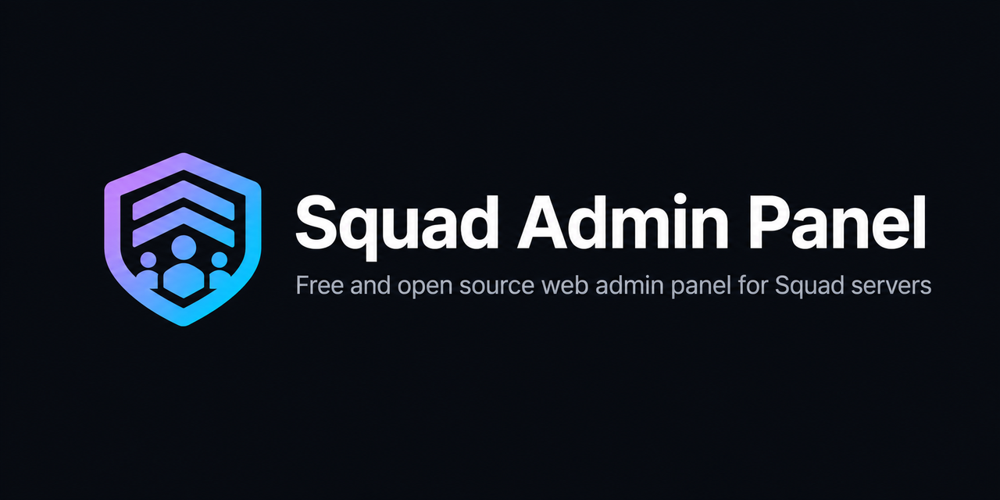

# Squad Admin Panel

**A free, open source Squad admin panel and RCON tool for Squad dedicated servers. It runs as a SquadJS plugin: kick, ban, warn and change the map from your browser instead of typing admin commands, with a live scoreboard, squads and chat, staff permissions, server logs and team balance (Smart Shuffle).**

[](./LICENSE)
[](https://github.com/Miabeyefendi/Squad-AdminPanel/releases/latest)
[](#-installation)
[](#-roadmap)
[](https://github.com/Miabeyefendi)

**English** · [Türkçe](./README_TR.md) · [Español](./README_ES.md) · [简体中文](./README_ZH.md) · [Русский](./README_RU.md)

[Install](#-installation) · [Features](#-highlights) · [Quick start](#-quick-start) · [Setup guide](./docs/SETUP.md) · [Changelog](./CHANGELOG.md)

<a href="https://github.com/Miabeyefendi/Squad-AdminPanel/releases/latest">
  
</a>
<a href="./docs/SETUP.md">
  <picture>
    <source media="(prefers-color-scheme: dark)" srcset="./assets/btn-tutorial-dark.svg">
    
  </picture>
</a>


</div>

> **Not yet tested with players.** Tested with automated tests, with real SquadJS against an emulated game, and over real RCON on an empty Squad v10.6.3 server (an earlier build). Check the first kicks and bans in game.

---

## 🎬 See it in action

<div align="center">
  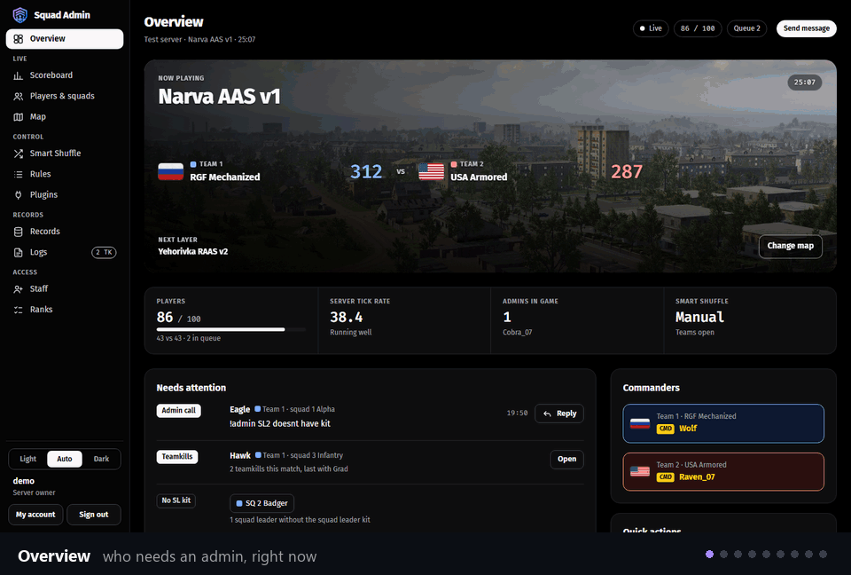
  <br/>
  <sub><b>A tour of the panel</b> · nine screens, demo data</sub>
</div>

---

## ✨ Highlights

- **Live scoreboard** - both teams side by side: kills, downs, deaths, K/D, revives, teamkills, damage, squad numbers
- **Players and squads** - squad lists with the live chat next to them, and a private on-screen message to one player
- **Admin actions** - warn, kick, ban (1 hour to permanent), move team, remove from squad, one player or many, always with a confirmation
- **Map control** - pick map, mode, version, factions and unit types, set the next layer or change now
- **Smart Shuffle built in** - team balancing with 11 presets and every setting, applied without a restart
- **Staff and permissions** - owner, admin, senior mod and junior mod, with per account ticks checked on the server
- **Player records and logs** - warnings, kicks, bans and notes that survive restarts, plus chat, kill, teamkill, admin and join logs with CSV export
- **Automatic rules** - teamkills, players without a squad, squad leaders without the SL kit, small locked squads, chat and name filters, all off by default
- **SquadJS plugin manager** - switch other plugins on and off and edit their settings from the browser
- **Server page** - player limit, queue limit and server password, automatic announcements, and one way Discord notices (bans, kicks, `!admin` calls), off by default
- **Players who just left** - the last 30 minutes with their teamkills and record, so they can still be banned; demote a commander or disband a squad with a button
- **Five languages** - English, Türkçe, Deutsch, Русский and 中文, picked with a flag at the top right; plugin setting names stay as the plugins write them
- **Self-hosted** - no account, no cloud service, no extra npm packages; encrypted data and brute force protection

---

## 📦 Installation

### Requirements

| | |
|---|---|
| Squad server | A dedicated server with RCON on, or a hosted one reachable by RCON with its logs over FTP or SFTP |
| [SquadJS](https://github.com/Team-Silver-Sphere/SquadJS) | Latest release, tested with 4.1.0 |
| Node.js | 18 or newer, as SquadJS needs. The panel was tested on Node 24 and 26, not on 18 |
| Browser | A current Chrome, Edge or Firefox |

### Built with


### Install

1. Download `Squad-AdminPanel-v1.1.0.zip` from the [releases page](https://github.com/Miabeyefendi/Squad-AdminPanel/releases/latest).
2. Extract `admin-panel.js` and the `admin-panel` folder into `squad-server/plugins/` of SquadJS.
3. Add this line to the `plugins` list in `config.json`:

   ```json
   { "plugin": "AdminPanel", "enabled": true, "port": 8170 }
   ```

4. Restart SquadJS. You should see `Admin panel on http://127.0.0.1:8170`.

First time with SquadJS? The [tutorial](./docs/SETUP.md#-installation) starts from zero, including RCON and SquadJS.

<details>
<summary><b>About the release file</b></summary>

The zip is a plain copy of `src/squadjs/` (tag `v1.1.0`) from this repository with `LICENSE` and `NOTICE` added inside `admin-panel/`. Nothing is compiled, minified or bundled.

`Squad-AdminPanel-v1.1.0.zip` SHA-256:

```
176a30cab3fc84ea552d5525b02fef8fbf80867120e8e36efaeb335b36d0e89c
```

</details>

---

## 🚀 Quick Start

1. **On the machine that runs SquadJS**, open `http://127.0.0.1:8170`.
2. Sign in with `admin` / `admin`. You are in. A warning stays at the top until you set your own password under **My account**.
3. Change it **before** putting any proxy or tunnel in front of the panel. While it is `admin` / `admin`, it works from the server itself only.

For access from your own computer or for several admins, see [remote access](./docs/SETUP.md#remote-access-and-more-admins).

---

## 🖼️ Screenshots

Names and numbers come from the built-in demo. The map and faction pictures in these screenshots are not part of the download: they were added through the panel's picture folder (see [Credits](#-credits)). Without them the panel draws its own.

<table>
<tr>
  <td align="center" width="50%">
    <br/>
    <sub><b>Scoreboard</b> · fixed columns, order held while you read</sub>
  </td>
  <td align="center" width="50%">
    <br/>
    <sub><b>Players and chat</b> · reply to one player from their line</sub>
  </td>
</tr>
<tr>
  <td align="center" width="50%">
    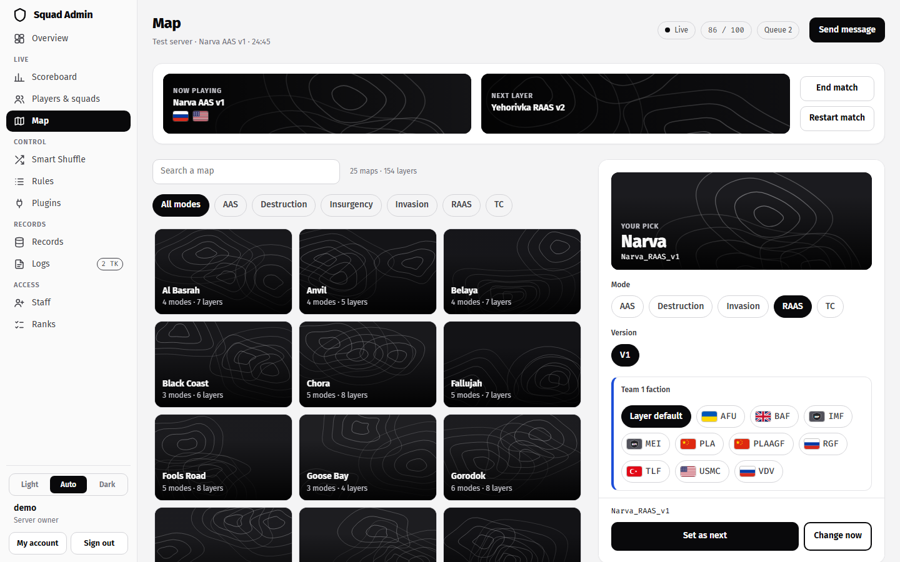<br/>
    <sub><b>Map control</b> · set next layer or change now</sub>
  </td>
  <td align="center" width="50%">
    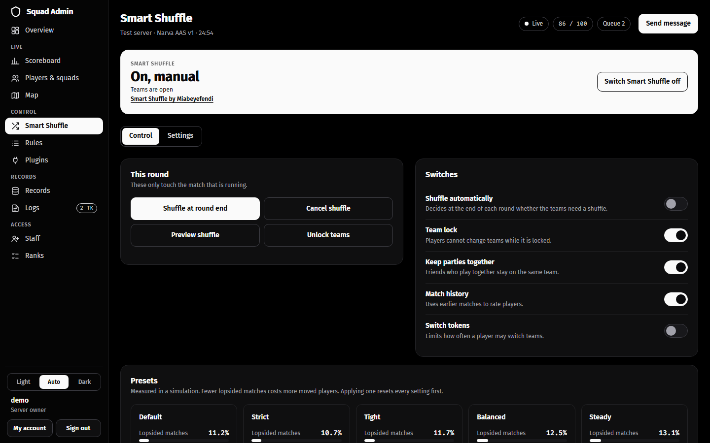<br/>
    <sub><b>Smart Shuffle</b> · team balance without a restart</sub>
  </td>
</tr>
<tr>
  <td align="center" width="50%">
    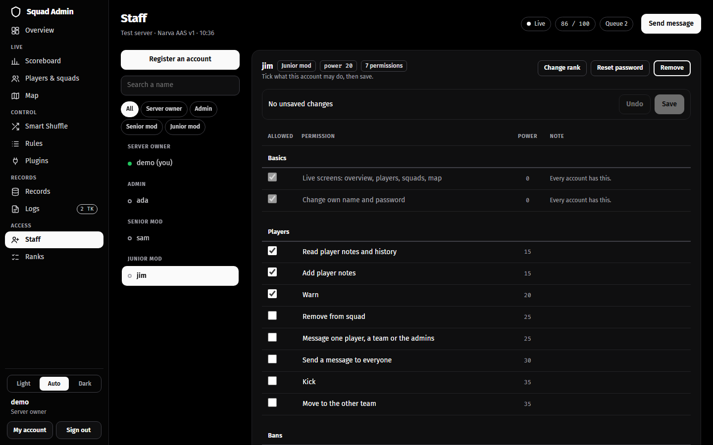<br/>
    <sub><b>Staff</b> · what each admin may do</sub>
  </td>
  <td align="center" width="50%">
    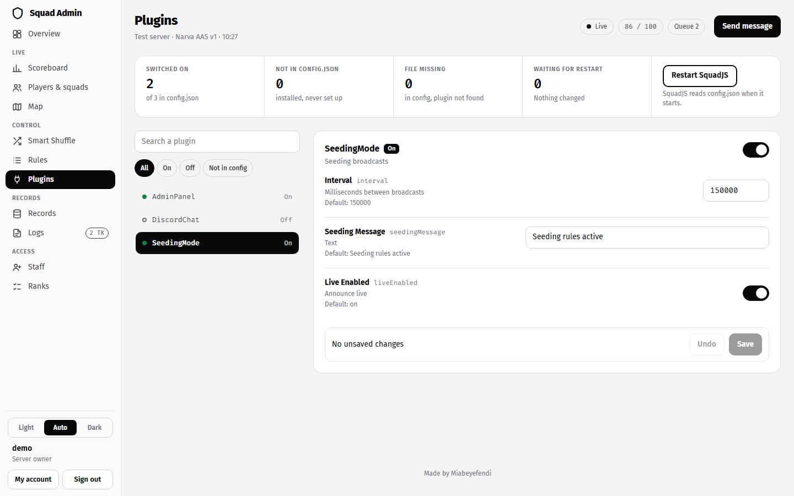<br/>
    <sub><b>Plugins</b> · settings become form fields</sub>
  </td>
</tr>
<tr>
  <td align="center" width="50%">
    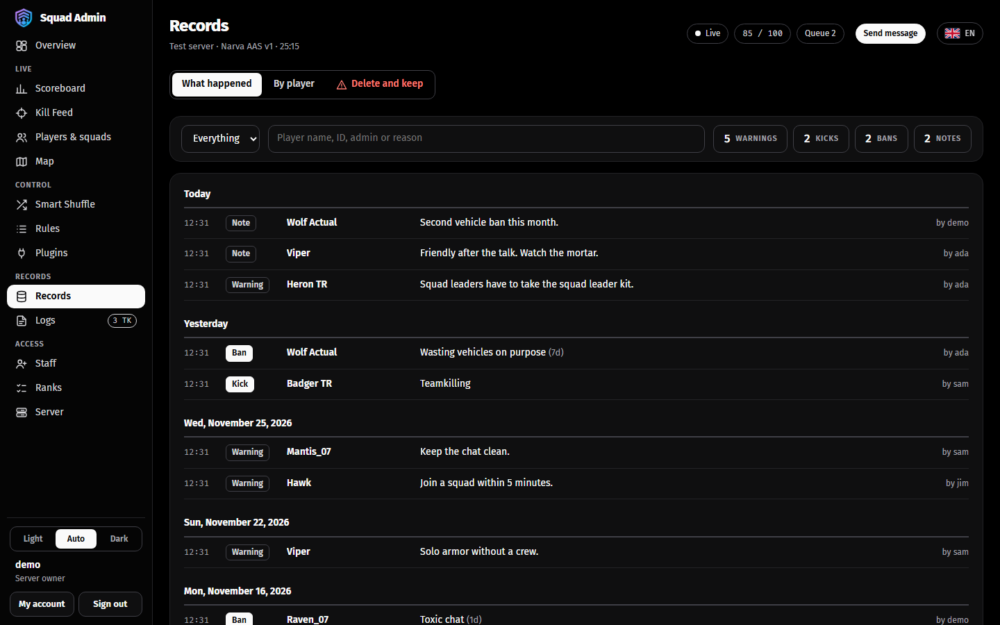<br/>
    <sub><b>Records</b> · every warning, kick, ban and note</sub>
  </td>
  <td align="center" width="50%">
    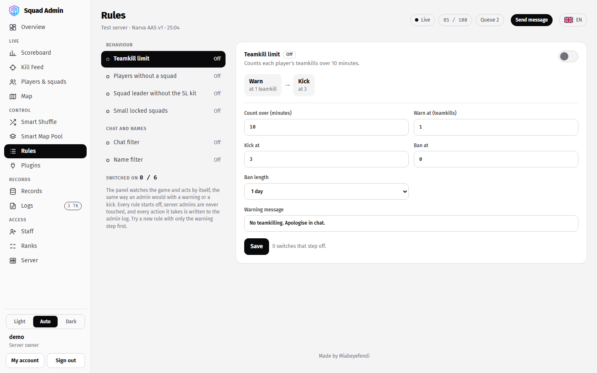<br/>
    <sub><b>Rules</b> · each says what it will do</sub>
  </td>
</tr>
<tr>
  <td align="center" width="50%">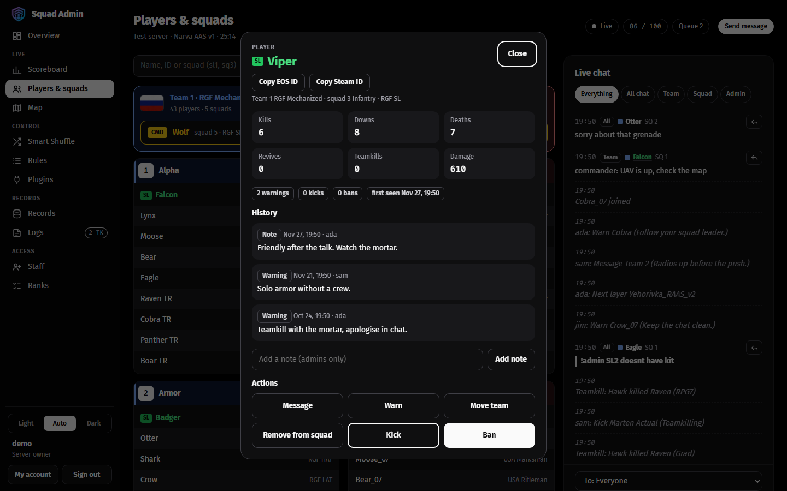<br/><sub><b>Player card</b> · history, notes, actions</sub></td>
  <td align="center" width="50%">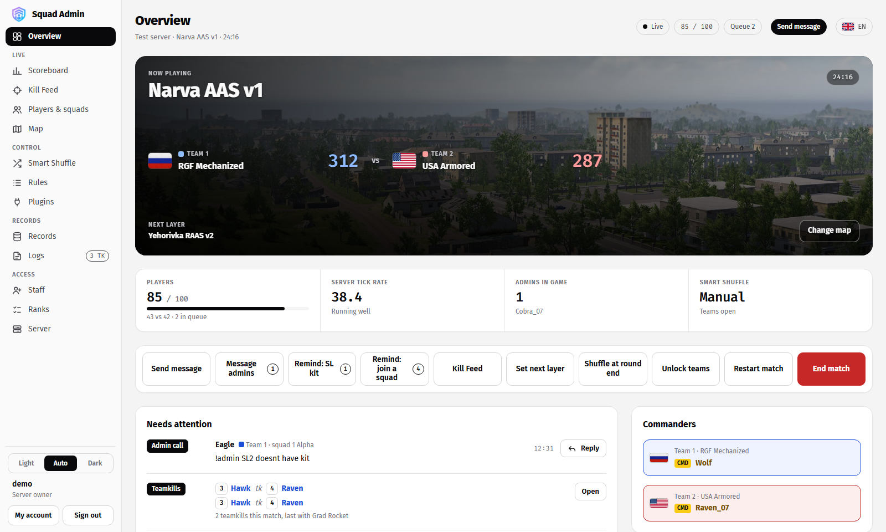<br/><sub><b>Light theme</b> · follows your system</sub></td>
</tr>
<tr>
  <td align="center" width="50%">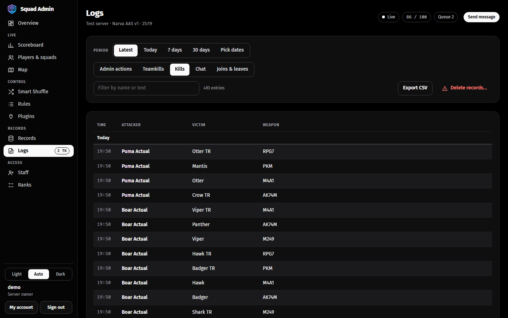<br/><sub><b>Logs</b> · any period, CSV export</sub></td>
  <td align="center" width="50%">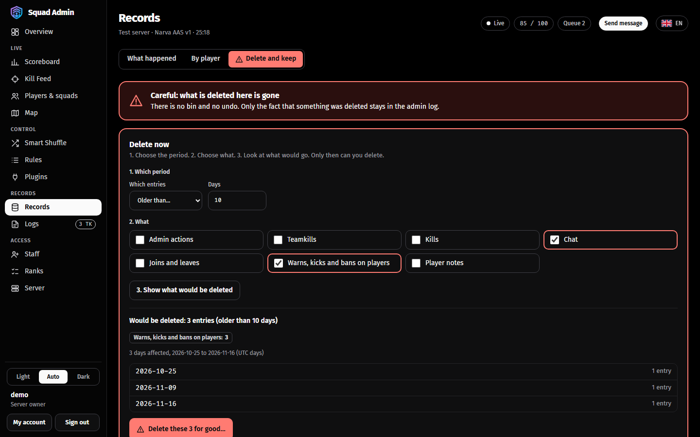<br/><sub><b>Safe deleting</b> · preview before anything goes</sub></td>
</tr>
<tr>
  <td align="center" width="50%">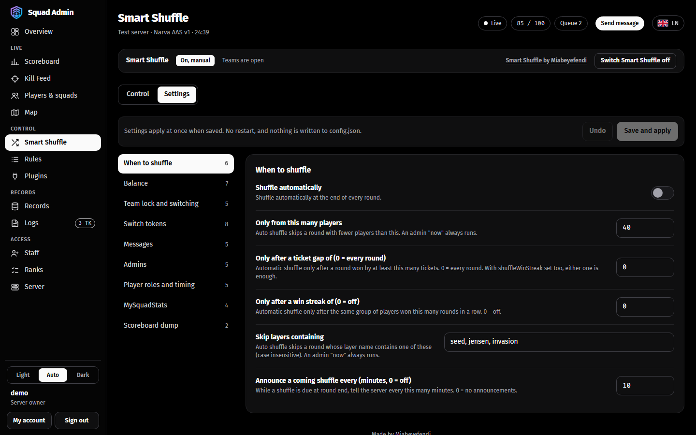<br/><sub><b>Shuffle settings</b> · one group at a time</sub></td>
  <td align="center" width="50%">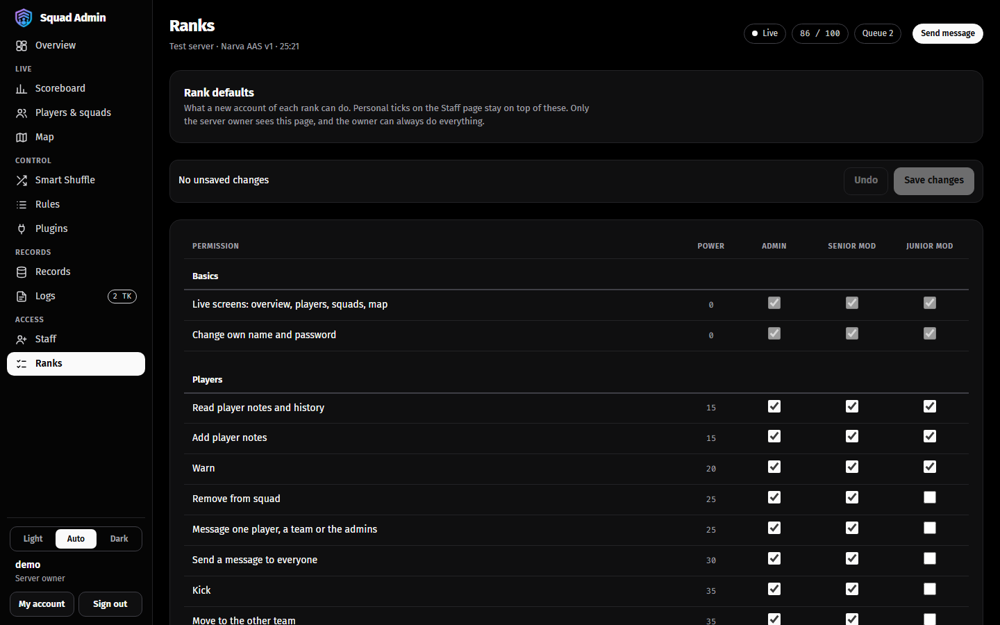<br/><sub><b>Ranks</b> · defaults side by side</sub></td>
</tr>
<tr>
  <td align="center" width="50%">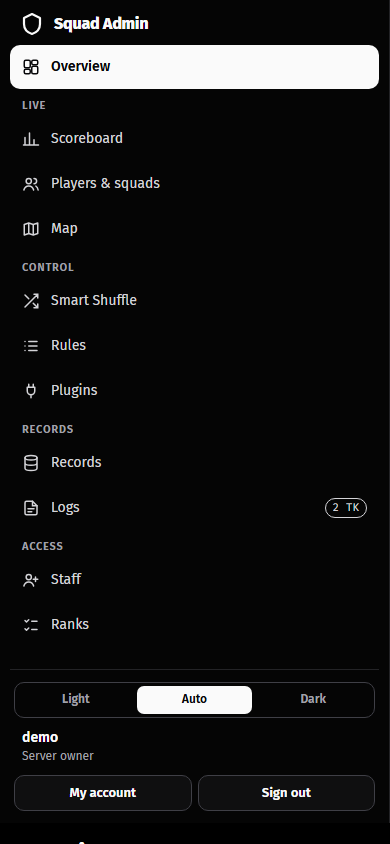<br/><sub><b>On a phone</b> · overview</sub></td>
  <td align="center" width="50%">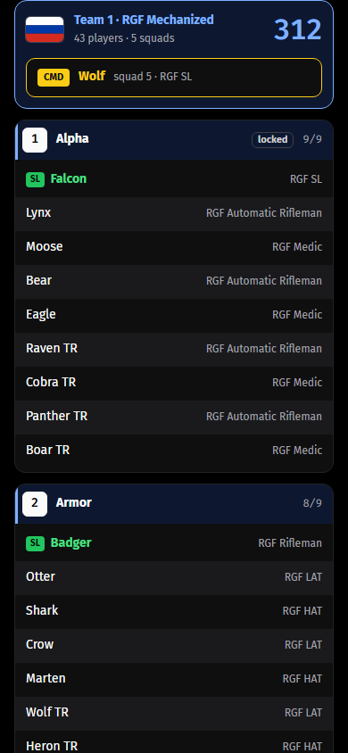<br/><sub><b>On a phone</b> · squads</sub></td>
</tr>
</table>

---

## ⚙️ Configuration

Panel settings go on the `AdminPanel` line of SquadJS `config.json`. **Put no passwords there:** SquadJS sends plugin options to its own ping service.

| Key | Default | What it does |
|---|---|---|
| `port` | `8170` | Port of the panel |
| `host` | `127.0.0.1` | Keep it; use a proxy or tunnel for remote access |
| `allowedHosts` | `[]` | Extra host names the panel answers to |
| `secureCookie`, `trustProxy` | `false` | Turn on behind an HTTPS reverse proxy on the same machine |
| `retentionDays` | `90` | Days logs are kept, 0 keeps them for ever |
| `dataDir` | `./admin-panel-data` | Accounts, records, rules and logs, encrypted |

Every key is in the [tutorial](./docs/SETUP.md#️-configuration-reference).

---

## 📖 Documentation

- [**Squad admin commands**](./docs/ADMIN_COMMANDS.md) - kick, ban, warn, change map, Admins.cfg and admin camera controls ([Türkçe](./docs/ADMIN_KOMUTLARI_TR.md))
- [**Setup guide**](./docs/SETUP.md) - installation from zero, every page, every setting, troubleshooting ([Türkçe](./docs/KURULUM_TR.md))
- [**Changelog**](./CHANGELOG.md) - what changed in each release
- [**Contributing**](./CONTRIBUTING.md) - how to send a change
- [**Security**](./SECURITY.md) - how to report a vulnerability privately

For developers: `npm test` runs the unit and HTTP tests against a fake server, `npm run demo` starts the panel on a fake server at `http://127.0.0.1:8171`, and `SQUADJS_DIR=<SquadJS folder> node tests/integration/emulate-game.mjs` runs real SquadJS against an emulated game.

---

## 🧭 Roadmap

- [ ] Testing on a live match with players
- [ ] Easier remote access and a setup code instead of the first `admin` account
- [ ] Limits on how many kicks and bans one account can do in a short time

Nothing here is a promise. This is a personal project and the list moves when my priorities move.

---

## ❓ FAQ

<details>
<summary><b>Can I run Squad admin commands from a browser?</b></summary>

Yes, the daily ones: kick, ban, warn, broadcast, move team, remove from squad, change layer, set next layer, end and restart match. See the [Squad admin commands reference](./docs/ADMIN_COMMANDS.md) for which button sends which command.

</details>

<details>
<summary><b>Do I need BattleMetrics or another RCON service?</b></summary>

No. The panel runs on your own server and talks to the game through SquadJS. It is not a copy of any paid service: for example it has no ban lists shared between communities.

</details>

<details>
<summary><b>Does it edit Admins.cfg or give an admin camera?</b></summary>

No. Panel accounts and permissions are separate from `Admins.cfg`, and the admin camera is part of the game. The [commands reference](./docs/ADMIN_COMMANDS.md#adminscfg-how-to-add-an-admin) explains both.

</details>

<details>
<summary><b>Is it really free?</b></summary>

Yes. It is open source under the AGPL-3.0, with no paid tier and no account.

</details>

<details>
<summary><b>Why is there no score or ping on the scoreboard?</b></summary>

Squad sends neither over RCON nor writes them to the server log. The other numbers are counted from the log while the panel runs.

</details>

<details>
<summary><b>How does it know who the commander is?</b></summary>

The player list has no commander field. The panel takes the leader of the squad named "Command Squad". Anyone can use that name; with two on one team the lower squad number counts and the panel warns you. Not yet confirmed on a live match.

</details>

<details>
<summary><b>What is still untested?</b></summary>

Warn, kick, ban, move team and remove from squad have not run against a real player. Disbanding a squad (locked squad rule) has not run on a real server. Damage numbers have not been checked against a real match log. New in 1.1.0 and not yet run on a real game server: demoting a commander, disbanding a squad by button, banning a player who left, the player and queue limits and the server password. No message has been sent to a real Discord channel.

</details>

---

## 🤝 Contributing

Contributions are welcome. Read [CONTRIBUTING.md](./CONTRIBUTING.md) and [CODE_OF_CONDUCT.md](./CODE_OF_CONDUCT.md) first. By contributing you agree to license your work under the AGPL-3.0.

<div align="center">
<a href="https://github.com/Miabeyefendi/Squad-AdminPanel/issues/new?template=bug_report.yml">
  <picture>
    <source media="(prefers-color-scheme: dark)" srcset="./assets/btn-report-bug-dark.svg">
    
  </picture>
</a>
<a href="https://github.com/Miabeyefendi/Squad-AdminPanel/stargazers">
  <picture>
    <source media="(prefers-color-scheme: dark)" srcset="./assets/btn-star-dark.svg">
    
  </picture>
</a>
</div>

---

## 🙏 Credits

- [**SquadJS**](https://github.com/Team-Silver-Sphere/SquadJS) by Team Silver Sphere (Boost Software License) - the framework this plugin runs in; it provides RCON, log reading and the layer list.
- [**Smart Shuffle**](https://github.com/Miabeyefendi/Squad-SmartShuffle) - my team balance plugin, included in `admin-panel/smart-shuffle/` with its own [LICENSE](./src/squadjs/admin-panel/smart-shuffle/LICENSE) and [NOTICE](./src/squadjs/admin-panel/smart-shuffle/NOTICE).
- Pictures seen in the screenshots: map images from the [Squad Wiki Pipeline](https://github.com/Squad-Wiki/squad-wiki-pipeline-map-data) (CC BY-SA 4.0, resized), faction flags from [SquadCalc](https://github.com/sh4rkman/SquadCalc). Squad game content belongs to Offworld Industries. Scenery pictures of the running match and the top-down maps of Black Coast, Harju, Pacific Proving Grounds and Sanxian: [Squad Wiki](https://squad.fandom.com/wiki/Maps) (resized, some cut to 16:9).

---

## 🛡️ Security

- Passwords are stored only as salted scrypt hashes; wrong tries are blocked with a growing wait.
- Accounts, records, rules and logs are encrypted with AES-256-GCM. The key is `secret.key` in the data folder, or the `SA_DATA_KEY` environment variable.
- Strict Content-Security-Policy, cross-site requests refused, host name checked, every value checked before it reaches RCON or `config.json`.
- Search engines and known scanners get `noindex` or 403. This does not hide an open port: keep the panel on `127.0.0.1` behind a VPN, SSH tunnel or HTTPS proxy.
- **Limit to know:** whoever can read and change files on your server can take over the panel. Protect the server login, and never hand it to moderators.

Found a vulnerability? Do not open a public issue. Follow [SECURITY.md](./SECURITY.md).

---

## 📜 License

This project is licensed under the **GNU Affero General Public License v3.0 (AGPL-3.0)**, together with the supplemental terms in the [NOTICE](./NOTICE) file. In short:

- You may use, study, modify, redistribute and even make money with this software for free, **as long as** you keep the complete source code available under the AGPL-3.0, including for any hosted, SaaS or network use (AGPL Section 13), and you preserve the author attribution below.
- To use this work in a closed-source or proprietary product, or to run it as a closed SaaS, you need a **separate written commercial license**, which may include a royalty or revenue share. See [NOTICE](./NOTICE), Section 8, and contact me.

### Attribution (required)

Per AGPL-3.0 Section 7(b), the following attribution must be preserved, visibly and unmodified, in any copy, fork or deployment of this project:

> **Miabeyefendi (Mustafa Ihsan Albayrak)** - https://github.com/Miabeyefendi

### Disclaimer

This software is provided "as is", without warranty of any kind. You run it entirely at your own risk and are solely responsible for your own use, including compliance with the terms of service of any third-party platform it interacts with. This is an unofficial tool, not affiliated with or endorsed by Offworld Industries or the SquadJS authors; their names and trademarks belong to their respective owners. The author accepts no liability for account bans, data loss or any other damages, to the maximum extent permitted by applicable law. Full terms are in the [LICENSE](./LICENSE) and [NOTICE](./NOTICE) files.

---

## 📬 Contact

- GitHub: [@miabeyefendi](https://github.com/Miabeyefendi)
- For commercial licensing or revenue-sharing enquiries, reach me through my GitHub profile.

<div align="center">
<br/>

<br/>
<sub>Built by <b><a href="https://github.com/Miabeyefendi">Miabeyefendi</a></b></sub>
</div>
