<div align="center">

<picture>
  <source media="(prefers-color-scheme: dark)" srcset="./assets/logo-dark.svg">
  
</picture>

# Squad Admin Panel

**Бесплатная веб-панель администратора с открытым кодом для серверов Squad. Работает как плагин SquadJS: живая таблица счёта, отряды и чат, предупреждения, кик и бан, управление картами, права администраторов, журналы и Smart Shuffle.**

[](./LICENSE)
[](https://github.com/Miabeyefendi/Squad-AdminPanel/releases/latest)
[](#-установка)
[](#-планы)
[](https://github.com/Miabeyefendi)

[English](./README.md) · [Türkçe](./README_TR.md) · [Español](./README_ES.md) · [简体中文](./README_ZH.md) · **Русский**

[Установка](#-установка) · [Возможности](#-главное) · [Быстрый старт](#-быстрый-старт) · [Руководство (англ.)](./docs/SETUP.md) · [Изменения](./CHANGELOG.md)

<a href="https://github.com/Miabeyefendi/Squad-AdminPanel/releases/latest">
  
</a>
<a href="./docs/SETUP.md">
  <picture>
    <source media="(prefers-color-scheme: dark)" srcset="./assets/btn-tutorial-dark.svg">
    
  </picture>
</a>


</div>

> **Бета.** Проверено автоматическими тестами, настоящим SquadJS с имитацией игры и настоящим RCON на пустом сервере Squad v10.6.3 (версия 0.1.0). **В матче с игроками ещё не проверялось.**

---

## 🎬 В действии

<div align="center">
  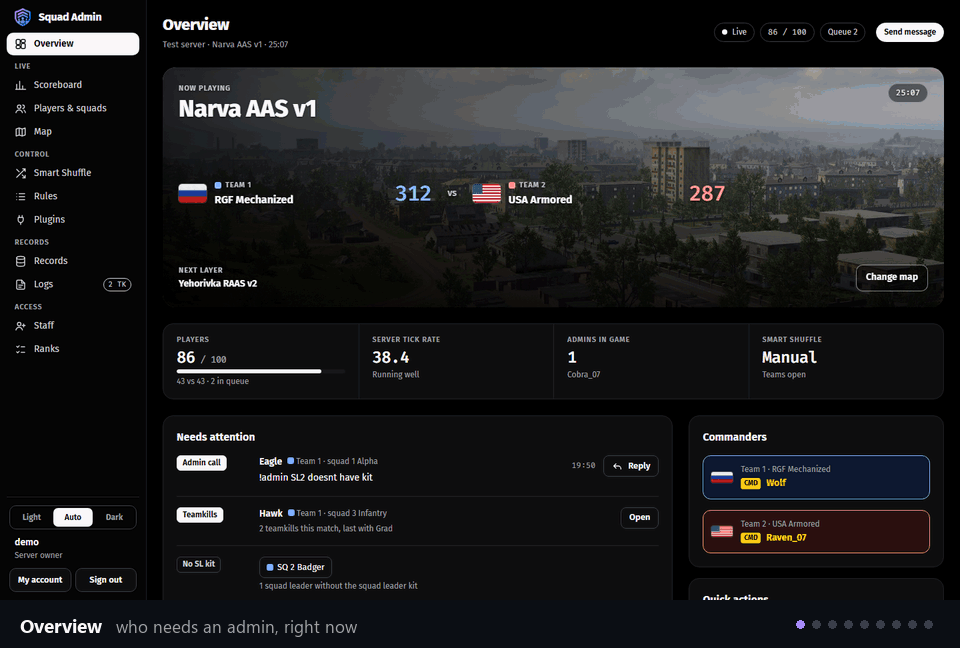
  <br/>
  <sub><b>Обзор панели</b> · девять экранов, демо-данные</sub>
</div>

---

## ✨ Главное

- **Живая таблица** - обе команды рядом: убийства, нокауты, смерти, K/D, реанимации, тимкиллы, урон, номера отрядов
- **Игроки и отряды** - списки рядом с живым чатом и личное сообщение игроку на экран
- **Действия админа** - предупреждение, кик, бан, смена команды, исключение из отряда, всегда с подтверждением
- **Карты** - карта, режим, версия, фракции и подразделения; следующая карта или смена сейчас
- **Встроенный Smart Shuffle** - баланс команд с 11 пресетами без перезапуска
- **Права** - владелец, админ, старший и младший модератор; проверяются на сервере
- **Записи и журналы** - предупреждения, кики, баны и заметки переживают перезапуск; экспорт в CSV
- **Автоматические правила** - по умолчанию выключены
- **Управление плагинами SquadJS** - включайте и настраивайте их в браузере
- **Свой сервер** - без аккаунтов и облака, без дополнительных пакетов npm, данные зашифрованы

---

## 📦 Установка

### Требования

| | |
|---|---|
| Сервер Squad | С включённым RCON, или на хостинге с RCON и логами по FTP или SFTP |
| [SquadJS](https://github.com/Team-Silver-Sphere/SquadJS) | Последняя версия, проверено на 4.1.0 |
| Node.js | 18 или новее. Панель проверена на Node 24 и 26, на 18 не проверялась |
| Браузер | Свежий Chrome, Edge или Firefox |

### Технологии


### Установить

1. Скачайте `Squad-AdminPanel-v0.5.0.zip` со [страницы релизов](https://github.com/Miabeyefendi/Squad-AdminPanel/releases/latest).
2. Распакуйте `admin-panel.js` и папку `admin-panel` в `squad-server/plugins/` SquadJS.
3. Добавьте в список `plugins` файла `config.json`:

   ```json
   { "plugin": "AdminPanel", "enabled": true, "port": 8170 }
   ```

4. Перезапустите SquadJS. Должна появиться строка `Admin panel on http://127.0.0.1:8170`.

<details>
<summary><b>О файле релиза</b></summary>

Архив - это копия `src/squadjs/` из репозитория с `LICENSE` и `NOTICE` внутри `admin-panel/`. Без сборки и минификации.

SHA-256 файла `Squad-AdminPanel-v0.5.0.zip`:

```
abf5f817f06184f7f3319e8dbababece23f6ce736a587100d44790624d2d5cd7
```

</details>

---

## 🚀 Быстрый старт

1. **На машине, где работает SquadJS**, откройте `http://127.0.0.1:8170`.
2. Войдите как `admin` / `admin`. Панель сразу попросит задать свои имя и пароль.
3. Сделайте это **до** настройки прокси или туннеля перед панелью.

Удалённый доступ описан в [руководстве](./docs/SETUP.md#remote-access-and-more-admins).

---

## 🖼️ Скриншоты

Имена и числа взяты из демо. Флаги и узоры карт нарисованы самой панелью; игровых изображений нет.

<table>
<tr>
  <td align="center" width="50%">
    <br/>
    <sub><b>Таблица</b> · фиксированные столбцы</sub>
  </td>
  <td align="center" width="50%">
    <br/>
    <sub><b>Игроки и чат</b> · ответ одному</sub>
  </td>
</tr>
<tr>
  <td align="center" width="50%">
    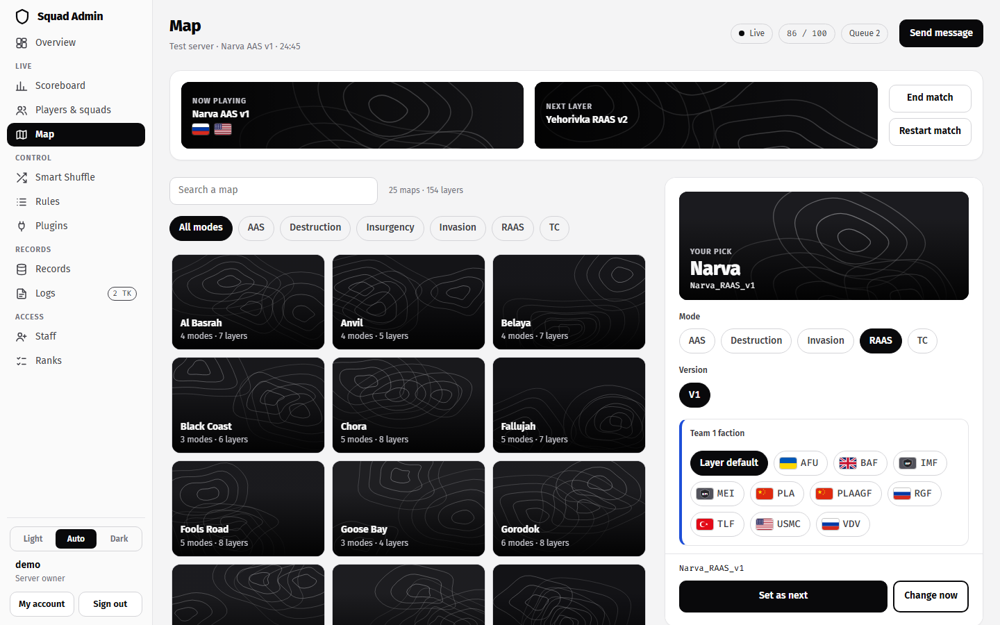<br/>
    <sub><b>Карты</b> · следующая или сейчас</sub>
  </td>
  <td align="center" width="50%">
    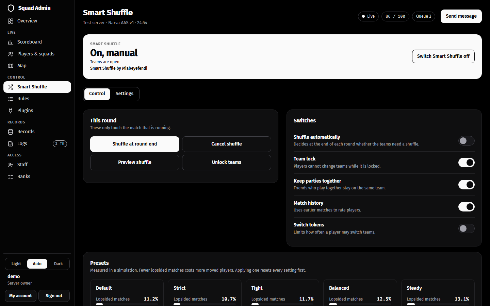<br/>
    <sub><b>Smart Shuffle</b> · баланс без перезапуска</sub>
  </td>
</tr>
<tr>
  <td align="center" width="50%">
    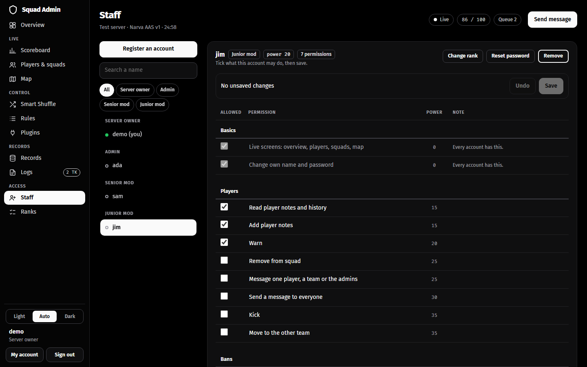<br/>
    <sub><b>Права</b> · что может каждый админ</sub>
  </td>
  <td align="center" width="50%">
    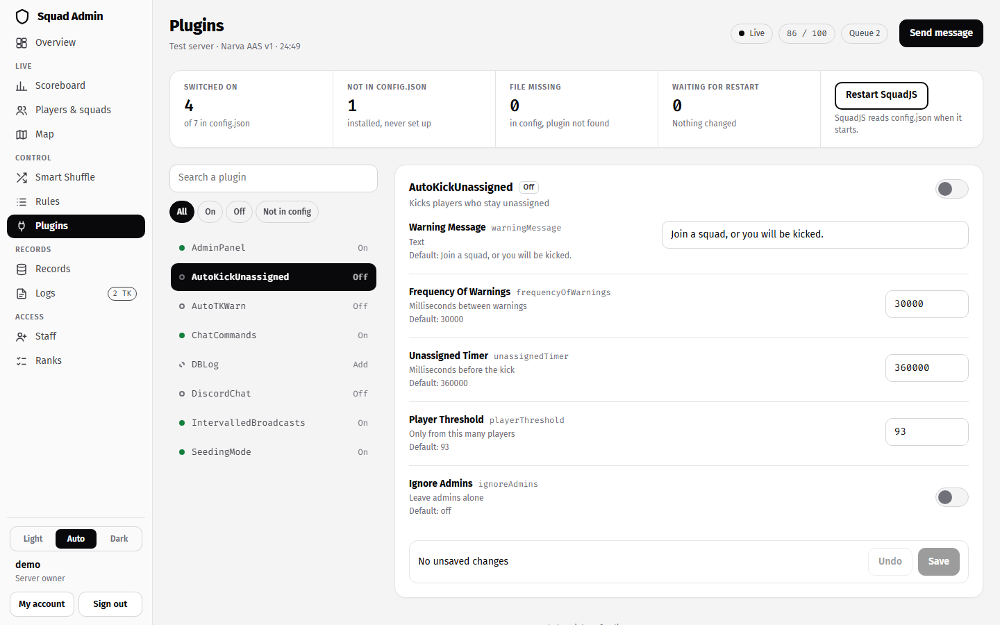<br/>
    <sub><b>Плагины</b> · настройки в виде формы</sub>
  </td>
</tr>
<tr>
  <td align="center" width="50%">
    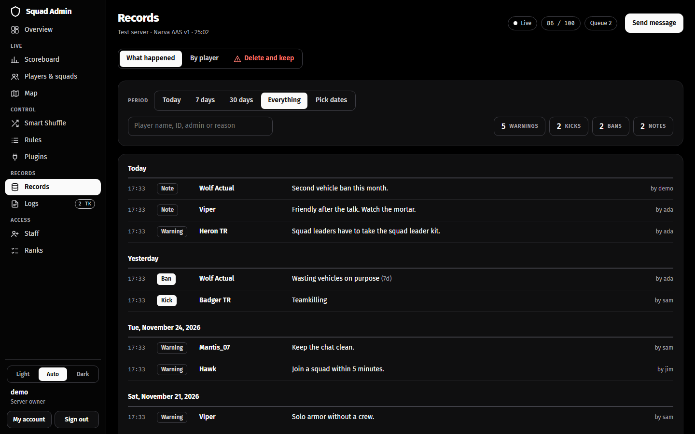<br/>
    <sub><b>Записи</b> · предупреждения, кики, баны, заметки</sub>
  </td>
  <td align="center" width="50%">
    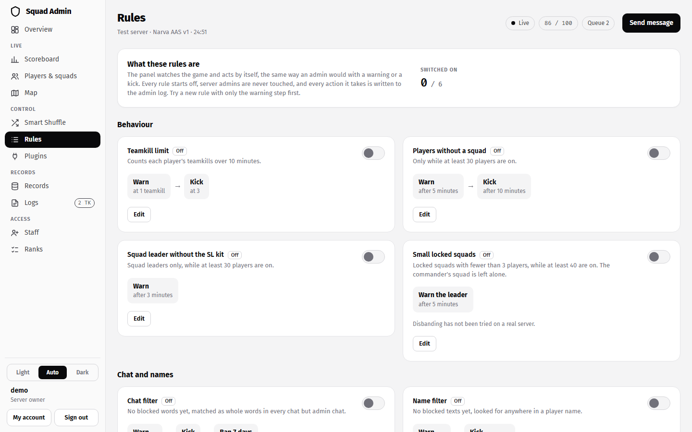<br/>
    <sub><b>Правила</b> · каждое говорит, что сделает</sub>
  </td>
</tr>
<tr>
  <td align="center" width="50%">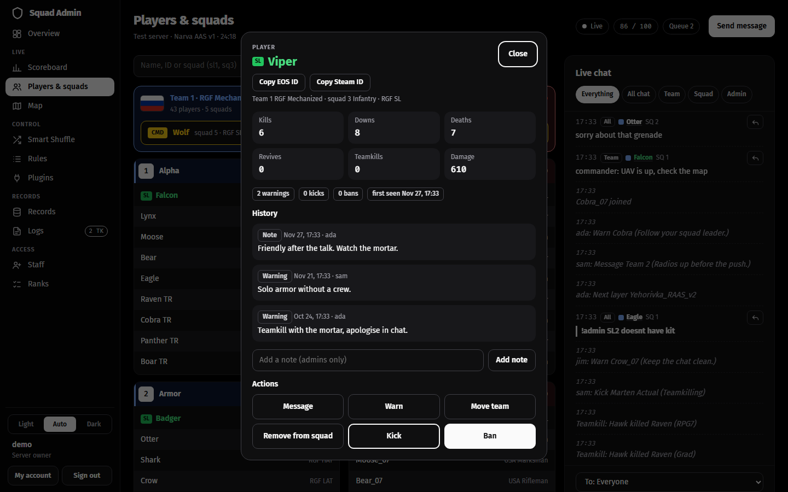<br/><sub><b>Карточка игрока</b> · история, заметки, действия</sub></td>
  <td align="center" width="50%">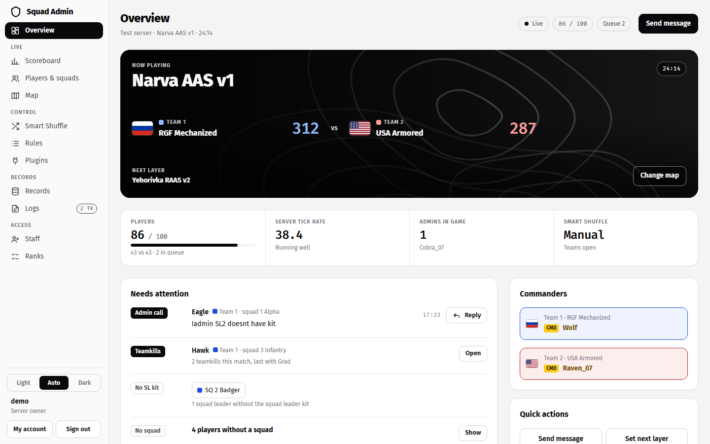<br/><sub><b>Светлая тема</b> · как в системе</sub></td>
</tr>
<tr>
  <td align="center" width="50%">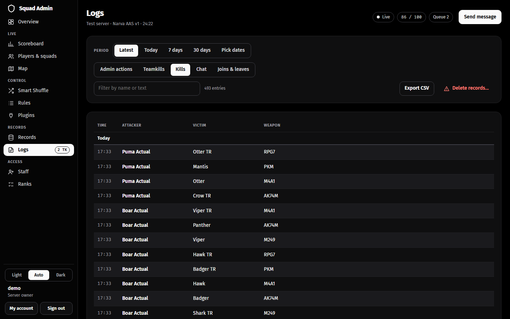<br/><sub><b>Журналы</b> · любой период, CSV</sub></td>
  <td align="center" width="50%">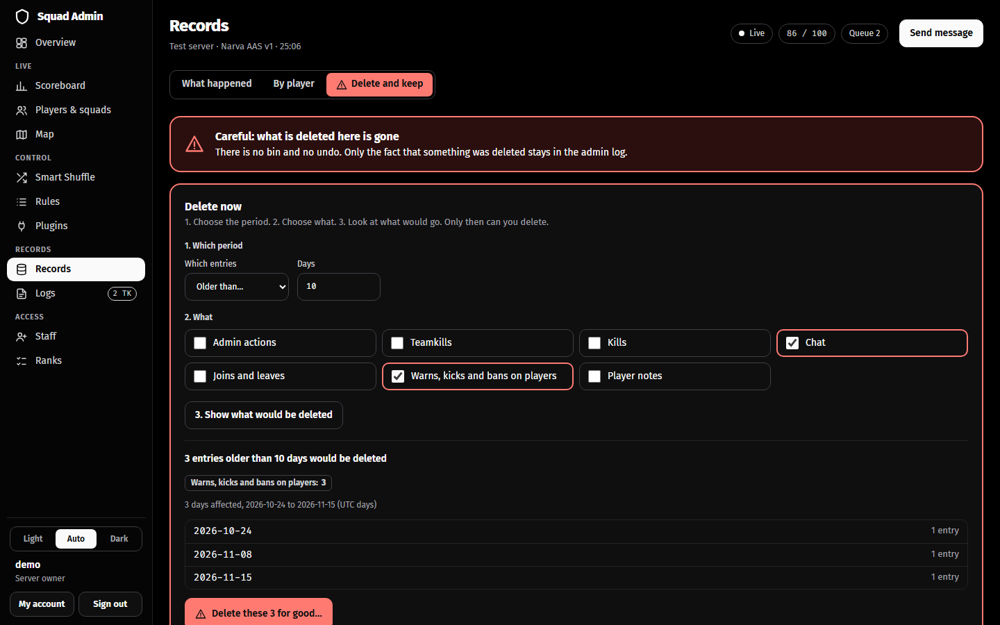<br/><sub><b>Безопасное удаление</b> · сначала предпросмотр</sub></td>
</tr>
<tr>
  <td align="center" width="50%">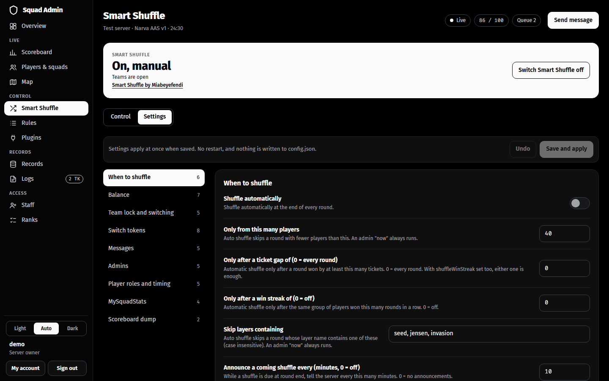<br/><sub><b>Настройки Shuffle</b> · по группам</sub></td>
  <td align="center" width="50%">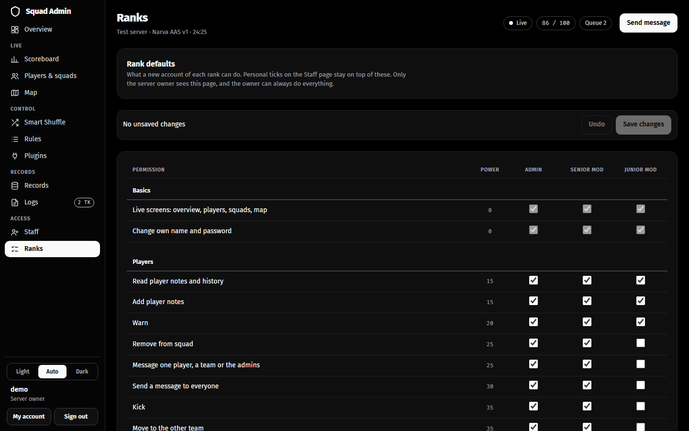<br/><sub><b>Ранги</b> · права рядом</sub></td>
</tr>
<tr>
  <td align="center" width="50%">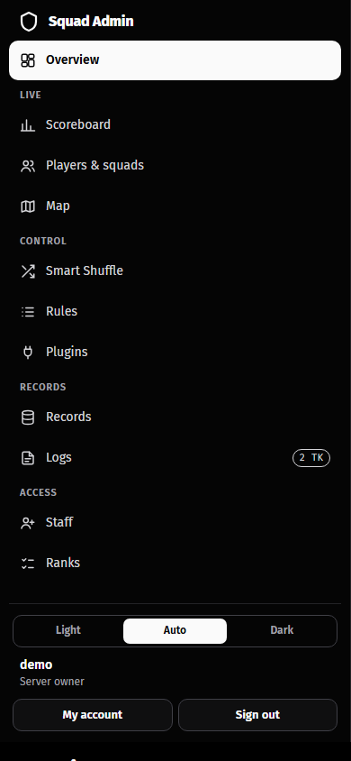<br/><sub><b>На телефоне</b> · сводка</sub></td>
  <td align="center" width="50%">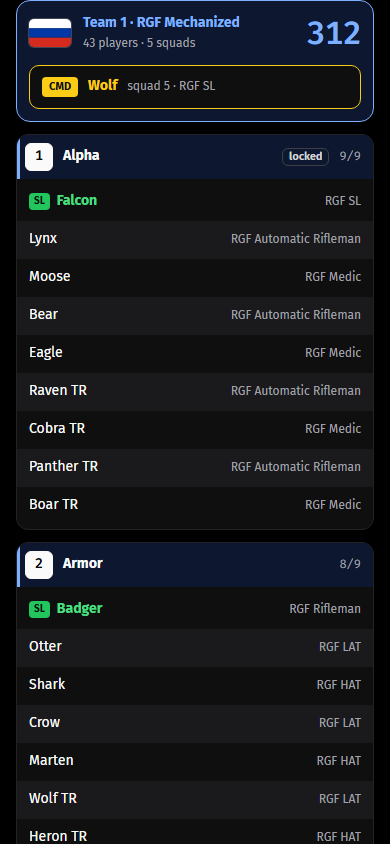<br/><sub><b>На телефоне</b> · отряды</sub></td>
</tr>
</table>

---

## ⚙️ Настройка

Настройки задаются в строке `AdminPanel` файла `config.json`. **Не пишите туда пароли:** SquadJS отправляет настройки плагинов на свой сервис. Все параметры - в [руководстве](./docs/SETUP.md#️-configuration-reference).

| Параметр | По умолчанию | Назначение |
|---|---|---|
| `port` | `8170` | Порт панели |
| `host` | `127.0.0.1` | Не меняйте; для удалённого доступа нужен прокси или туннель |
| `allowedHosts` | `[]` | Дополнительные имена хоста |
| `secureCookie`, `trustProxy` | `false` | Включите за HTTPS-прокси на той же машине |
| `retentionDays` | `90` | Сколько дней хранить логи, 0 - всегда |
| `dataDir` | `./admin-panel-data` | Аккаунты, записи, правила и логи, зашифрованы |

---

## 📖 Документация

- [**Руководство**](./docs/SETUP.md) (англ.)
- [**Изменения**](./CHANGELOG.md)
- [**Участие**](./CONTRIBUTING.md)
- [**Безопасность**](./SECURITY.md)

---

## 🧭 Планы

- [ ] Проверка в настоящем матче с игроками
- [ ] Более простой удалённый доступ и код установки вместо первого аккаунта `admin`
- [ ] Ограничение числа киков и банов с одного аккаунта

Это не обещания.

---

## ❓ Частые вопросы

<details>
<summary><b>Это действительно бесплатно?</b></summary>

Да, открытый код под AGPL-3.0.

</details>

<details>
<summary><b>Почему нет счёта и пинга?</b></summary>

Squad не передаёт их по RCON и не пишет в лог.

</details>

<details>
<summary><b>Как определяется командир?</b></summary>

В списке игроков такого поля нет. Панель считает командиром лидера отряда "Command Squad". Это имя может взять любой; если в команде два таких отряда, берётся меньший номер, и панель предупреждает. В настоящем матче не подтверждено.

</details>

<details>
<summary><b>Что ещё не проверено?</b></summary>

Действия над настоящими игроками, расформирование отряда и значения урона в настоящем матче.

</details>

---

## 🤝 Участие

Прочитайте [CONTRIBUTING.md](./CONTRIBUTING.md) и [CODE_OF_CONDUCT.md](./CODE_OF_CONDUCT.md).

<div align="center">
<a href="https://github.com/Miabeyefendi/Squad-AdminPanel/issues/new?template=bug_report.yml">
  <picture>
    <source media="(prefers-color-scheme: dark)" srcset="./assets/btn-report-bug-dark.svg">
    
  </picture>
</a>
<a href="https://github.com/Miabeyefendi/Squad-AdminPanel/stargazers">
  <picture>
    <source media="(prefers-color-scheme: dark)" srcset="./assets/btn-star-dark.svg">
    
  </picture>
</a>
</div>

---

## 🙏 Благодарности

- [**SquadJS**](https://github.com/Team-Silver-Sphere/SquadJS) от Team Silver Sphere (Boost Software License) - основа, в которой работает плагин.
- [**Smart Shuffle**](https://github.com/Miabeyefendi/Squad-SmartShuffle) - мой плагин баланса, включён со своими LICENSE и NOTICE.

---

## 🛡️ Безопасность

- Пароли хранятся только как соли и хеши scrypt; неверные попытки блокируются.
- Данные зашифрованы AES-256-GCM.
- **Важно:** тот, кто может читать и менять файлы на сервере, может захватить панель. Не давайте доступ к серверу модераторам.

Об уязвимостях сообщайте по [SECURITY.md](./SECURITY.md).

---

## 📜 Лицензия

**GNU AGPL-3.0** с дополнительными условиями из [NOTICE](./NOTICE). Можно использовать, изменять и зарабатывать, если полный исходный код остаётся открытым под AGPL-3.0, в том числе при работе по сети (раздел 13), и сохранено указание автора. Для закрытого продукта нужна отдельная письменная коммерческая лицензия (NOTICE, раздел 8).

### Указание автора (обязательно)

> **Miabeyefendi (Mustafa Ihsan Albayrak)** - https://github.com/Miabeyefendi

### Отказ от ответственности

Программа поставляется "как есть", без гарантий, вы используете её на свой риск. Это неофициальный инструмент, не связанный с Offworld Industries и авторами SquadJS. См. [LICENSE](./LICENSE) и [NOTICE](./NOTICE).

---

## 📬 Контакты

- GitHub: [@miabeyefendi](https://github.com/Miabeyefendi)

<div align="center">
<br/>

<br/>
<sub>Built by <b><a href="https://github.com/Miabeyefendi">Miabeyefendi</a></b></sub>
</div>
