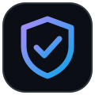
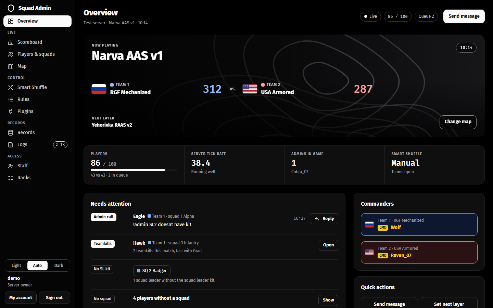
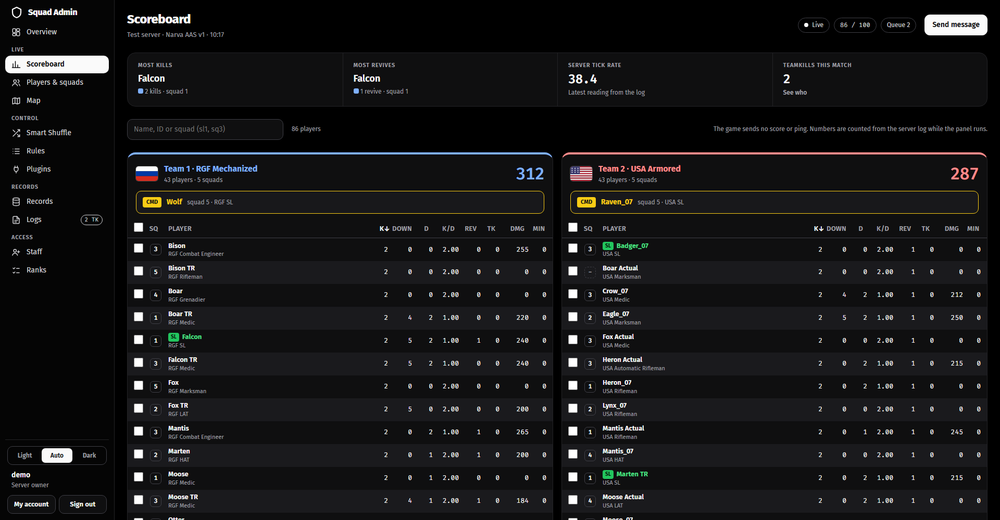
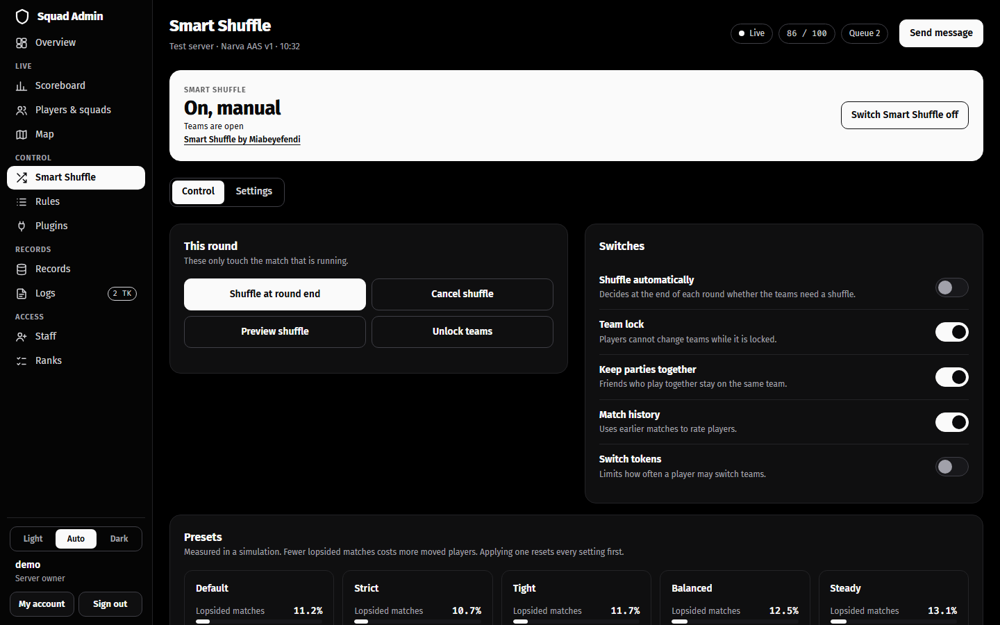
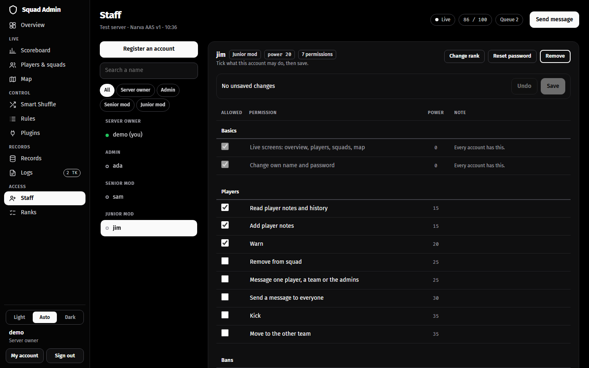
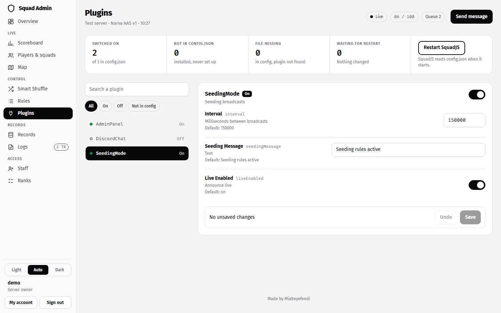
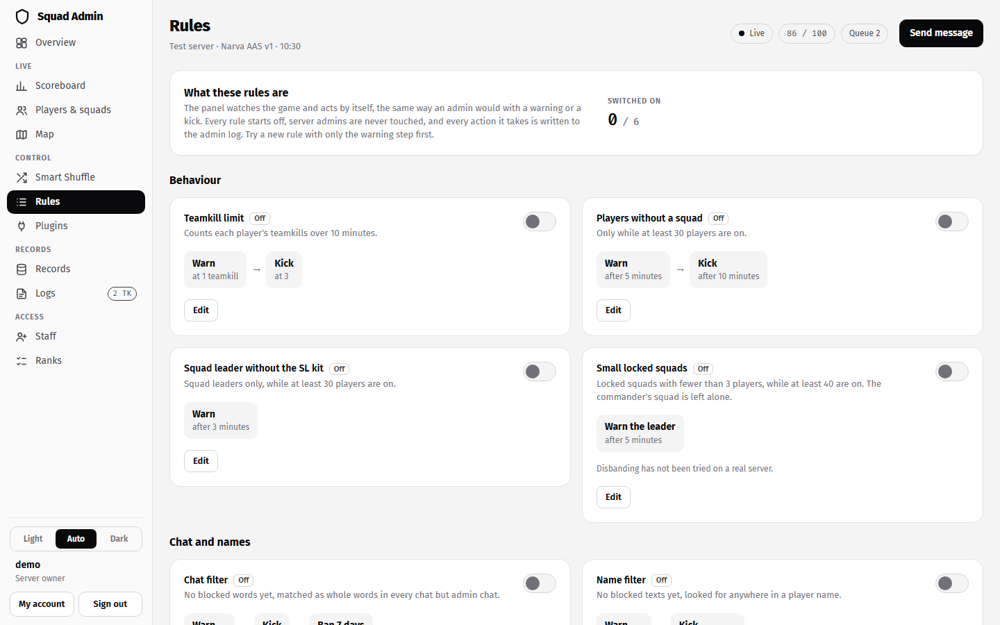

<div align="center">

<picture>
  <source media="(prefers-color-scheme: dark)" srcset="./assets/logo-dark.svg">
  
</picture>

# Squad Admin Panel

**Squad oyun sunucuları için ücretsiz, açık kaynak web admin paneli. SquadJS eklentisi olarak çalışır: canlı skor tablosu, squad'lar ve chat, uyarı, kick ve ban, harita kontrolü, admin yetkileri, loglar ve Smart Shuffle.**

[](./LICENSE)
[](https://github.com/Miabeyefendi/Squad-AdminPanel/releases/latest)
[](#-kurulum)
[](#-yol-haritası)
[](https://github.com/Miabeyefendi)

[English](./README.md) · **Türkçe** · [Español](./README_ES.md) · [简体中文](./README_ZH.md) · [Русский](./README_RU.md)

[Kurulum](#-kurulum) · [Özellikler](#-öne-çıkanlar) · [Hızlı başlangıç](#-hızlı-başlangıç) · [Adım adım rehber](./docs/KURULUM_TR.md) · [Değişiklikler](./CHANGELOG.md)

<a href="https://github.com/Miabeyefendi/Squad-AdminPanel/releases/latest">
  
</a>
<a href="./docs/KURULUM_TR.md">
  <picture>
    <source media="(prefers-color-scheme: dark)" srcset="./assets/btn-tutorial-dark.svg">
    
  </picture>
</a>



</div>

> **Deneme sürümü (beta).** Otomatik testlerle, gerçek SquadJS ve sahte oyunla, bir de boş bir Squad v10.6.3 sunucusunda gerçek RCON ile (0.1.0 sürümü) denendi. **Oyunculu gerçek maçta henüz denenmedi.** İlk kick ve banları oyunda kontrol et.

**Hiç bilmiyorsan:** [adım adım Türkçe rehber](./docs/KURULUM_TR.md) sıfırdan anlatır.

---

## ✨ Öne çıkanlar

- **Canlı skor tablosu** - iki takım yan yana: kill, down, ölüm, K/D, revive, teamkill, hasar, squad numaraları
- **Oyuncular ve squad'lar** - squad listesi yanında canlı chat, tek oyuncuya ekranda özel mesaj
- **Admin işlemleri** - uyarı, kick, ban (1 saatten kalıcıya), takım değiştirme, squad'dan çıkarma, tek ya da toplu, hep onaylı
- **Harita kontrolü** - harita, mod, versiyon, faction ve birim seçimi, sıradaki harita ya da hemen değiştirme
- **Smart Shuffle dahil** - 11 hazır ayar ve tüm ayarlarla takım dengeleme, yeniden başlatmadan
- **Admin yetkileri** - sunucu sahibi, admin, senior mod, junior mod, hesap bazında yetki, sunucuda denetlenir
- **Kayıtlar ve loglar** - yeniden başlatmada silinmeyen uyarı, kick, ban, not; chat, kill, teamkill logları, CSV
- **Otomatik kurallar** - teamkill, squad'sız oyuncu, kitsiz SL, küçük kilitli squad, chat ve isim filtresi, hepsi kapalı gelir
- **SquadJS eklenti yöneticisi** - diğer eklentileri tarayıcıdan aç, kapat, ayarla
- **Kendi sunucunda** - hesap yok, bulut yok, ek npm paketi yok; şifreli veri ve deneme-yanılma koruması

---

## 📦 Kurulum

### Gerekenler

| | |
|---|---|
| Squad sunucusu | RCON açık dedicated sunucu, ya da RCON'a ve FTP/SFTP ile loglara erişilen hosting |
| [SquadJS](https://github.com/Team-Silver-Sphere/SquadJS) | Son sürüm, 4.1.0 ile denendi |
| Node.js | 18 ya da daha yeni. Panel Node 24 ve 26 ile denendi, 18 ile denenmedi |
| Tarayıcı | Güncel Chrome, Edge ya da Firefox |

### Kullanılanlar


### Kur

1. [Sürüm sayfasından](https://github.com/Miabeyefendi/Squad-AdminPanel/releases/latest) `Squad-AdminPanel-v0.5.0.zip` dosyasını indir.
2. İçindeki `admin-panel.js` ve `admin-panel` klasörünü SquadJS'in `squad-server/plugins/` klasörüne çıkar.
3. `config.json` içindeki `plugins` listesine ekle:

   ```json
   { "plugin": "AdminPanel", "enabled": true, "port": 8170 }
   ```

4. SquadJS'i yeniden başlat. `Admin panel on http://127.0.0.1:8170` yazmalı.

<details>
<summary><b>Sürüm dosyası hakkında</b></summary>

Zip, bu depodaki `src/squadjs/` klasörünün düz kopyasıdır, `admin-panel/` içine `LICENSE` ve `NOTICE` eklenmiştir. Derleme, küçültme ya da paketleme yoktur.

`Squad-AdminPanel-v0.5.0.zip` SHA-256:

```
abf5f817f06184f7f3319e8dbababece23f6ce736a587100d44790624d2d5cd7
```

</details>

---

## 🚀 Hızlı başlangıç

1. **SquadJS'in çalıştığı bilgisayarda** `http://127.0.0.1:8170` adresini aç.
2. `admin` / `admin` ile gir. Panel hemen kendi adını ve parolanı ister.
3. Bunu panelin önüne proxy ya da tünel koymadan **önce** yap. İlk hesap yalnızca sunucunun kendisinden kullanılmak içindir.

Başka bilgisayardan ya da birden fazla admin için: [uzaktan giriş](./docs/KURULUM_TR.md#başka-adminlerin-ve-uzaktan-giriş).

---

## 🖼️ Ekran görüntüleri

Tüm isim ve sayılar demodandır. Bayraklar ve harita desenleri panelin kendi çizimidir, oyun görseli yoktur.

<table>
<tr>
  <td align="center" width="50%">
    <br/>
    <sub><b>Skor tablosu</b> · sabit sütunlar</sub>
  </td>
  <td align="center" width="50%">
    <br/>
    <sub><b>Oyuncular ve chat</b> · tek kişiye yanıt</sub>
  </td>
</tr>
<tr>
  <td align="center" width="50%">
    <br/>
    <sub><b>Harita</b> · sıradaki ya da hemen</sub>
  </td>
  <td align="center" width="50%">
    <br/>
    <sub><b>Smart Shuffle</b> · yeniden başlatmadan denge</sub>
  </td>
</tr>
<tr>
  <td align="center" width="50%">
    <br/>
    <sub><b>Yetkiler</b> · kim ne yapabilir</sub>
  </td>
  <td align="center" width="50%">
    <br/>
    <sub><b>Eklentiler</b> · ayarlar form olur</sub>
  </td>
</tr>
<tr>
  <td align="center" width="50%">
    <br/>
    <sub><b>Kayıtlar</b> · her uyarı, kick, ban ve not</sub>
  </td>
  <td align="center" width="50%">
    <br/>
    <sub><b>Kurallar</b> · her biri ne yapacağını söyler</sub>
  </td>
</tr>
</table>

---

## ⚙️ Ayarlar

Panel ayarları `config.json` içindeki `AdminPanel` satırındadır. **Oraya parola yazma:** SquadJS eklenti ayarlarını kendi sunucusuna gönderir. Tüm ayarlar [rehberde](./docs/KURULUM_TR.md#️-ayarlar).

| Ayar | Hazır değer | Ne yapar |
|---|---|---|
| `port` | `8170` | Panelin portu |
| `host` | `127.0.0.1` | Değiştirme; uzaktan erişim için proxy ya da tünel kullan |
| `allowedHosts` | `[]` | Panelin cevap verdiği ek alan adları |
| `secureCookie`, `trustProxy` | `false` | Aynı bilgisayardaki HTTPS proxy arkasında aç |
| `retentionDays` | `90` | Logların tutulduğu gün, 0 sonsuza kadar |
| `dataDir` | `./admin-panel-data` | Hesaplar, kayıtlar, kurallar ve loglar, şifreli |

---

## 📖 Belgeler

- [**Rehber**](./docs/KURULUM_TR.md) - sıfırdan kurulum, her sayfa, her ayar, sorun giderme
- [**Değişiklikler**](./CHANGELOG.md)
- [**Katkı**](./CONTRIBUTING.md)
- [**Güvenlik**](./SECURITY.md)

---

## 🧭 Yol haritası

- [ ] Oyunculu gerçek maçta test
- [ ] Daha kolay uzaktan giriş ve ilk `admin` hesabı yerine kurulum kodu
- [ ] Bir hesabın kısa sürede atabileceği kick ve ban sayısına sınır

Hiçbiri söz değildir. Bu kişisel bir proje.

---

## ❓ SSS

<details>
<summary><b>Gerçekten ücretsiz mi?</b></summary>

Evet. AGPL-3.0 açık kaynak, ücretli sürüm ve hesap yok.

</details>

<details>
<summary><b>Skor tablosunda neden puan ve ping yok?</b></summary>

Squad bunları ne RCON ile ne logda veriyor.

</details>

<details>
<summary><b>Commander nasıl anlaşılıyor?</b></summary>

Oyuncu listesinde commander bilgisi yok. Panel "Command Squad" adlı squad'ın liderini commander sayar. Bu adı herkes kullanabilir; aynı takımda iki tane varsa küçük numaralı sayılır ve panel uyarır. Gerçek maçta henüz doğrulanmadı.

</details>

<details>
<summary><b>Neler henüz denenmedi?</b></summary>

Uyarı, kick, ban, takım değiştirme ve squad'dan çıkarma gerçek oyuncuya karşı denenmedi. Squad dağıtma gerçek sunucuda çalıştırılmadı. Hasar sayısı gerçek maç loguyla karşılaştırılmadı.

</details>

---

## 🤝 Katkı

Katkılar açıktır. Önce [CONTRIBUTING.md](./CONTRIBUTING.md) ve [CODE_OF_CONDUCT.md](./CODE_OF_CONDUCT.md) dosyalarını oku.

<div align="center">
<a href="https://github.com/Miabeyefendi/Squad-AdminPanel/issues/new?template=bug_report.yml">
  <picture>
    <source media="(prefers-color-scheme: dark)" srcset="./assets/btn-report-bug-dark.svg">
    
  </picture>
</a>
<a href="https://github.com/Miabeyefendi/Squad-AdminPanel/stargazers">
  <picture>
    <source media="(prefers-color-scheme: dark)" srcset="./assets/btn-star-dark.svg">
    
  </picture>
</a>
</div>

---

## 🙏 Emeği geçenler

- [**SquadJS**](https://github.com/Team-Silver-Sphere/SquadJS), Team Silver Sphere (Boost Software License) - eklentinin içinde çalıştığı altyapı; RCON, log okuma ve layer listesi ondan gelir.
- [**Smart Shuffle**](https://github.com/Miabeyefendi/Squad-SmartShuffle) - kendi takım dengeleme eklentim, `admin-panel/smart-shuffle/` içinde kendi LICENSE ve NOTICE dosyalarıyla.

---

## 🛡️ Güvenlik

- Parolalar yalnızca tuzlanmış scrypt özeti olarak saklanır; yanlış denemeler artan süreyle engellenir.
- Hesaplar, kayıtlar, kurallar ve loglar AES-256-GCM ile şifrelidir.
- Sıkı Content-Security-Policy, siteler arası istek reddi, host adı kontrolü, RCON ve `config.json`'a giden her değerin denetimi.
- **Bilmen gereken sınır:** sunucundaki dosyaları okuyup değiştirebilen biri paneli ele geçirebilir. Sunucu parolanı koru ve moderatörlere verme.

Açık bulursan herkese açık issue açma, [SECURITY.md](./SECURITY.md) dosyasını izle.

---

## 📜 Lisans

**GNU Affero General Public License v3.0 (AGPL-3.0)** ve [NOTICE](./NOTICE) dosyasındaki ek şartlar. Kısaca:

- Tüm kaynak kodu AGPL-3.0 altında açık tuttuğun (barındırılan ve ağ üzerinden kullanım dahil, Bölüm 13) ve aşağıdaki atfı koruduğun sürece kullanabilir, değiştirebilir, dağıtabilir, hatta para kazanabilirsin.
- Kapalı kaynak ürün ya da kapalı SaaS için **ayrı yazılı ticari lisans** gerekir. Bkz. [NOTICE](./NOTICE), Bölüm 8.

### Atıf (zorunlu)

> **Miabeyefendi (Mustafa İhsan Albayrak)** - https://github.com/Miabeyefendi

### Sorumluluk reddi

Yazılım "olduğu gibi", garanti olmadan sunulur. Kullanım tamamen kendi riskindedir. Bu resmi olmayan bir araçtır; Offworld Industries ya da SquadJS yazarlarıyla bağlantılı veya onlar tarafından onaylı değildir. Ayrıntılar [LICENSE](./LICENSE) ve [NOTICE](./NOTICE) dosyalarında.

---

## 📬 İletişim

- GitHub: [@miabeyefendi](https://github.com/Miabeyefendi)
- Ticari lisans için GitHub profilimden ulaş.

<div align="center">
<br/>

<br/>
<sub>Built by <b><a href="https://github.com/Miabeyefendi">Miabeyefendi</a></b></sub>
</div>
