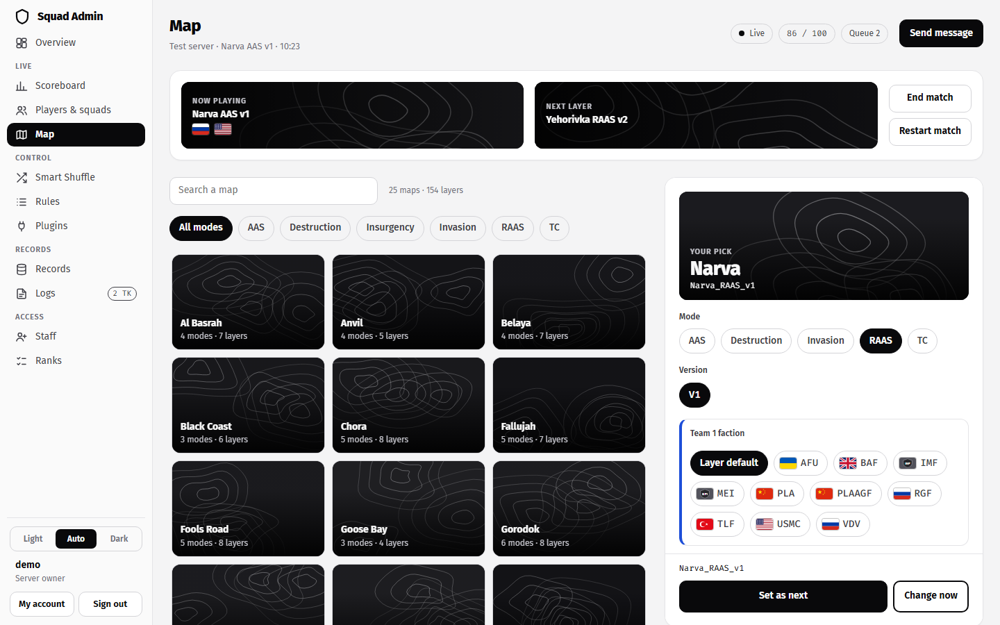
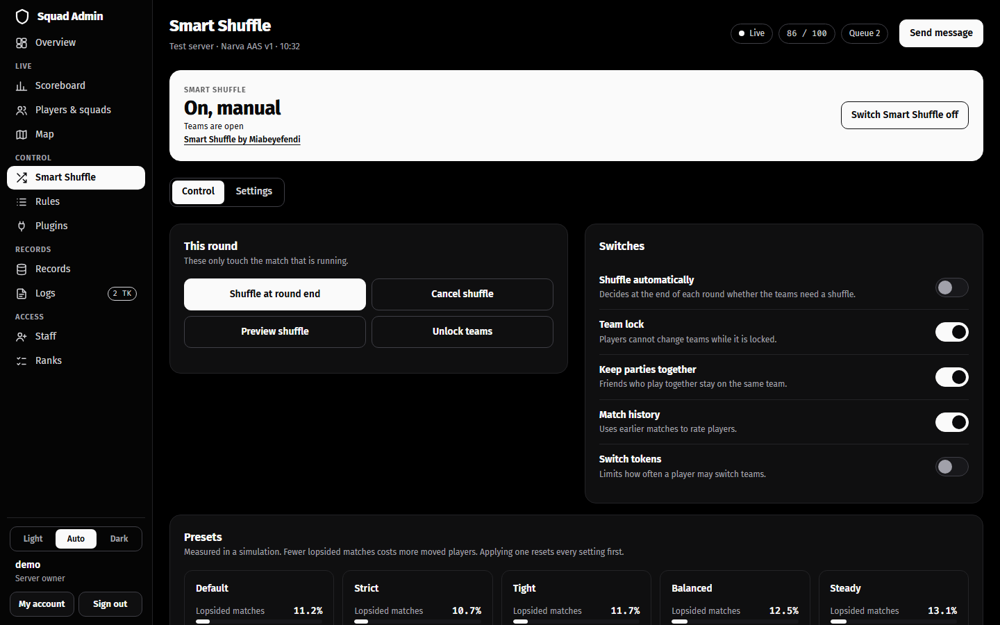
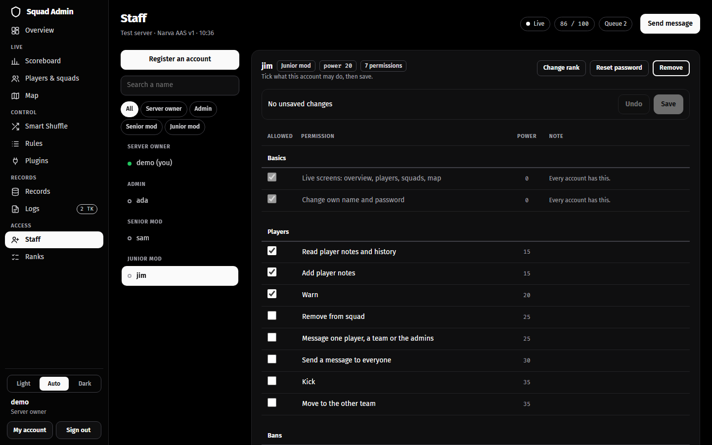
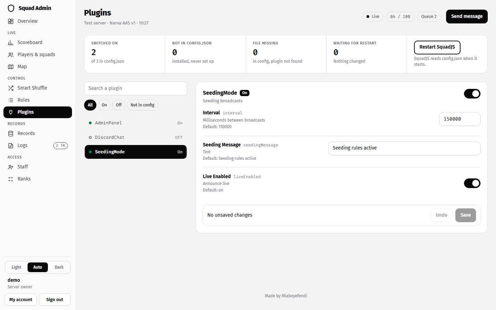
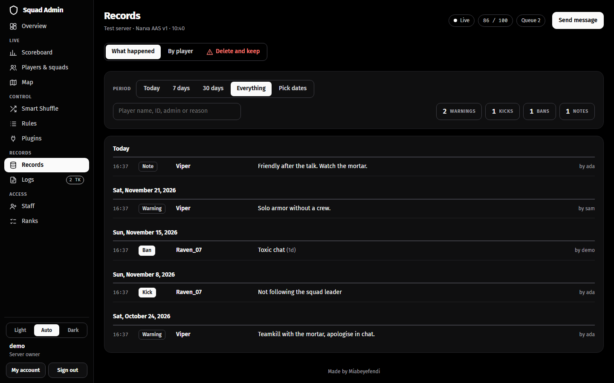
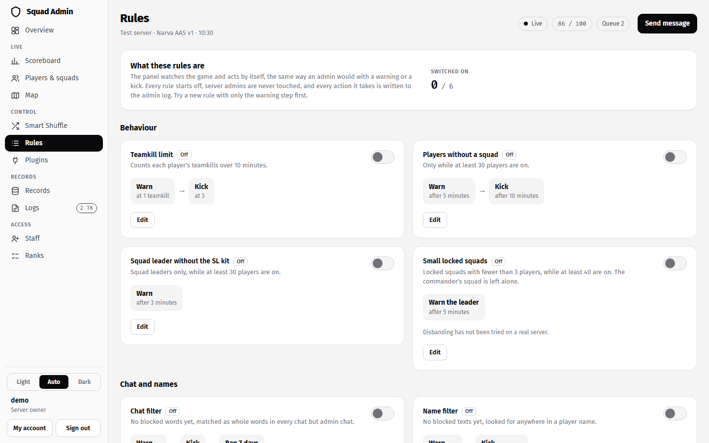

<div align="center">

<picture>
  <source media="(prefers-color-scheme: dark)" srcset="./assets/logo-dark.svg">
  
</picture>

# Squad Admin Panel

**面向 Squad(战术小队)游戏服务器的免费开源网页管理面板。以 SquadJS 插件形式运行:实时记分板、小队与聊天、警告、踢出与封禁、地图控制、管理员权限、日志以及 Smart Shuffle。**

[](./LICENSE)
[](https://github.com/Miabeyefendi/Squad-AdminPanel/releases/latest)
[](#-安装)
[](#-路线图)
[](https://github.com/Miabeyefendi)

[English](./README.md) · [Türkçe](./README_TR.md) · [Español](./README_ES.md) · **简体中文** · [Русский](./README_RU.md)

[安装](#-安装) · [功能](#-功能亮点) · [快速开始](#-快速开始) · [教程(英文)](./docs/SETUP.md) · [更新日志](./CHANGELOG.md)

<a href="https://github.com/Miabeyefendi/Squad-AdminPanel/releases/latest">
  
</a>
<a href="./docs/SETUP.md">
  <picture>
    <source media="(prefers-color-scheme: dark)" srcset="./assets/btn-tutorial-dark.svg">
    
  </picture>
</a>


</div>

> **测试版。** 已通过自动化测试、真实 SquadJS 对模拟游戏的测试,以及在空的 Squad v10.6.3 服务器上通过真实 RCON 的测试(0.1.0 版本)。**尚未在有玩家的实际对局中测试。**

---

## ✨ 功能亮点

- **实时记分板** - 两队并排:击杀、击倒、死亡、K/D、复活、误杀、伤害、小队编号
- **玩家与小队** - 小队列表旁显示实时聊天,可向单个玩家发送屏幕私信
- **管理操作** - 警告、踢出、封禁、换队、移出小队,每次操作都需确认
- **地图控制** - 选择地图、模式、版本、阵营和部队类型,设为下一局或立即切换
- **内置 Smart Shuffle** - 11 个预设的队伍平衡,无需重启即可生效
- **权限管理** - 服主、管理员、高级协管、初级协管,权限在服务器端校验
- **记录与日志** - 警告、踢出、封禁和备注在重启后保留,支持导出 CSV
- **自动规则** - 默认全部关闭
- **SquadJS 插件管理** - 在浏览器中启用和设置其他插件
- **自行托管** - 无需账号和云服务,无额外 npm 依赖,数据加密

---

## 📦 安装

### 环境要求

| | |
|---|---|
| Squad 服务器 | 开启 RCON 的专用服务器,或可通过 RCON 访问并经 FTP/SFTP 读取日志的托管服务器 |
| [SquadJS](https://github.com/Team-Silver-Sphere/SquadJS) | 最新版本,使用 4.1.0 测试 |
| Node.js | 18 或更高版本。面板在 Node 24 和 26 上测试过,未在 18 上测试 |
| 浏览器 | 新版 Chrome、Edge 或 Firefox |

### 技术栈


### 安装步骤

1. 从[发布页面](https://github.com/Miabeyefendi/Squad-AdminPanel/releases/latest)下载 `Squad-AdminPanel-v0.5.0.zip`。
2. 将 `admin-panel.js` 和 `admin-panel` 文件夹解压到 SquadJS 的 `squad-server/plugins/`。
3. 在 `config.json` 的 `plugins` 列表中添加:

   ```json
   { "plugin": "AdminPanel", "enabled": true, "port": 8170 }
   ```

4. 重启 SquadJS,应显示 `Admin panel on http://127.0.0.1:8170`。

<details>
<summary><b>关于发布文件</b></summary>

压缩包是本仓库 `src/squadjs/` 的原样副本,并在 `admin-panel/` 中加入了 `LICENSE` 和 `NOTICE`。没有编译、压缩或打包。

`Squad-AdminPanel-v0.5.0.zip` 的 SHA-256:

```
abf5f817f06184f7f3319e8dbababece23f6ce736a587100d44790624d2d5cd7
```

</details>

---

## 🚀 快速开始

1. **在运行 SquadJS 的机器上**打开 `http://127.0.0.1:8170`。
2. 使用 `admin` / `admin` 登录。面板会立即要求设置你自己的用户名和密码。
3. 请在面板前配置任何代理或隧道**之前**完成此步骤。

远程访问请参阅[教程](./docs/SETUP.md#remote-access-and-more-admins)。

---

## 🖼️ 截图

截图中的名称和数据来自演示模式。旗帜和地图图案由面板自行绘制,不包含任何游戏图片。

<table>
<tr>
  <td align="center" width="50%">
    <br/>
    <sub><b>记分板</b> · 固定列宽</sub>
  </td>
  <td align="center" width="50%">
    <br/>
    <sub><b>玩家与聊天</b> · 回复单个玩家</sub>
  </td>
</tr>
<tr>
  <td align="center" width="50%">
    <br/>
    <sub><b>地图控制</b> · 下一局或立即</sub>
  </td>
  <td align="center" width="50%">
    <br/>
    <sub><b>Smart Shuffle</b> · 无需重启的平衡</sub>
  </td>
</tr>
<tr>
  <td align="center" width="50%">
    <br/>
    <sub><b>权限</b> · 每个管理员能做什么</sub>
  </td>
  <td align="center" width="50%">
    <br/>
    <sub><b>插件</b> · 设置变成表单</sub>
  </td>
</tr>
<tr>
  <td align="center" width="50%">
    <br/>
    <sub><b>记录</b> · 全部警告、踢出、封禁和备注</sub>
  </td>
  <td align="center" width="50%">
    <br/>
    <sub><b>规则</b> · 每条都说明会做什么</sub>
  </td>
</tr>
</table>

---

## ⚙️ 配置

面板设置写在 `config.json` 的 `AdminPanel` 一行。**不要在其中填写密码:**SquadJS 会把插件选项发送到它自己的服务。全部选项见[教程](./docs/SETUP.md#️-configuration-reference)。

| 键 | 默认值 | 作用 |
|---|---|---|
| `port` | `8170` | 面板端口 |
| `host` | `127.0.0.1` | 请勿修改;远程访问用代理或隧道 |
| `allowedHosts` | `[]` | 面板额外响应的主机名 |
| `secureCookie`, `trustProxy` | `false` | 在本机 HTTPS 反向代理后开启 |
| `retentionDays` | `90` | 日志保留天数,0 为永久 |
| `dataDir` | `./admin-panel-data` | 账号、记录、规则和日志(加密) |

---

## 📖 文档

- [**教程**](./docs/SETUP.md)(英文)
- [**更新日志**](./CHANGELOG.md)
- [**参与贡献**](./CONTRIBUTING.md)
- [**安全**](./SECURITY.md)

---

## 🧭 路线图

- [ ] 在有玩家的实际对局中测试
- [ ] 更简单的远程访问,用安装码代替初始 `admin` 账号
- [ ] 限制单个账号短时间内的踢出和封禁次数

以上均不构成承诺。

---

## ❓ 常见问题

<details>
<summary><b>真的免费吗?</b></summary>

是的,以 AGPL-3.0 开源。

</details>

<details>
<summary><b>为什么没有分数和延迟?</b></summary>

Squad 既不通过 RCON 发送,也不写入服务器日志。

</details>

<details>
<summary><b>如何识别指挥官?</b></summary>

玩家列表中没有指挥官字段。面板把名为 "Command Squad" 的小队队长视为指挥官。任何人都能用这个名字;同一队出现两个时,以编号较小者为准并给出提示。尚未在实际对局中确认。

</details>

<details>
<summary><b>哪些内容尚未测试?</b></summary>

针对真实玩家的操作、解散小队,以及实际对局中的伤害数值。

</details>

---

## 🤝 参与贡献

请先阅读 [CONTRIBUTING.md](./CONTRIBUTING.md) 和 [CODE_OF_CONDUCT.md](./CODE_OF_CONDUCT.md)。

<div align="center">
<a href="https://github.com/Miabeyefendi/Squad-AdminPanel/issues/new?template=bug_report.yml">
  <picture>
    <source media="(prefers-color-scheme: dark)" srcset="./assets/btn-report-bug-dark.svg">
    
  </picture>
</a>
<a href="https://github.com/Miabeyefendi/Squad-AdminPanel/stargazers">
  <picture>
    <source media="(prefers-color-scheme: dark)" srcset="./assets/btn-star-dark.svg">
    
  </picture>
</a>
</div>

---

## 🙏 致谢

- Team Silver Sphere 的 [**SquadJS**](https://github.com/Team-Silver-Sphere/SquadJS)(Boost Software License),本插件运行的框架。
- [**Smart Shuffle**](https://github.com/Miabeyefendi/Squad-SmartShuffle),我的队伍平衡插件,附带其 LICENSE 和 NOTICE。

---

## 🛡️ 安全

- 密码仅以加盐 scrypt 哈希保存,错误尝试会被限制。
- 数据使用 AES-256-GCM 加密。
- **需要注意:**任何能读写服务器文件的人都可以接管面板。请勿把服务器登录信息交给协管。

发现漏洞请按 [SECURITY.md](./SECURITY.md) 私下报告。

---

## 📜 许可证

**GNU AGPL-3.0**,并附加 [NOTICE](./NOTICE) 中的条款。只要按 AGPL-3.0 公开完整源代码(包括网络使用,第 13 条)并保留署名,即可使用、修改并用于盈利。闭源使用需要单独的书面商业许可(NOTICE 第 8 节)。

### 署名(必须保留)

> **Miabeyefendi (Mustafa Ihsan Albayrak)** - https://github.com/Miabeyefendi

### 免责声明

本软件按"原样"提供,不附带任何担保,使用风险自负。本项目为非官方工具,与 Offworld Industries 及 SquadJS 作者无关联。详见 [LICENSE](./LICENSE) 和 [NOTICE](./NOTICE)。

---

## 📬 联系方式

- GitHub:[@miabeyefendi](https://github.com/Miabeyefendi)

<div align="center">
<br/>

<br/>
<sub>Built by <b><a href="https://github.com/Miabeyefendi">Miabeyefendi</a></b></sub>
</div>
