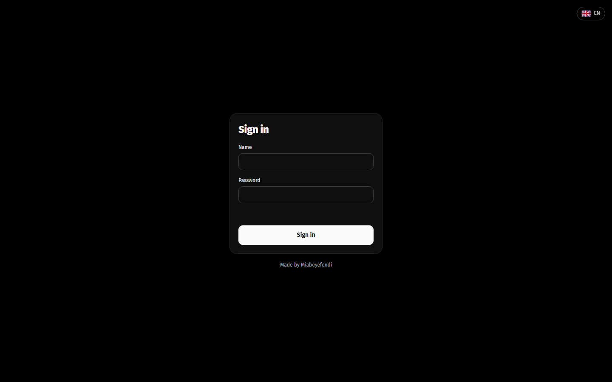
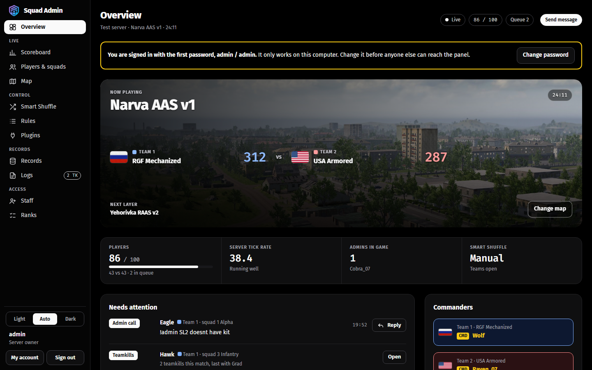

<div align="center">

# 📖 Squad Admin Panel Rehberi

**v1.0.0 · Son güncelleme 2026-11-27**

[English](./SETUP.md) · **Türkçe**

[README'ye dön](../README_TR.md) · [Değişiklikler](../CHANGELOG.md)

</div>

---

Bu rehber hiç bilmeyen biri için yazıldı. **Adımları sırayla yap, atlama.** Her adımın sonunda ne görmen gerektiği yazıyor. Onu görmüyorsan sonraki adıma geçme, [Sorun giderme](#-sorun-giderme) bölümüne bak.

## 📑 İçindekiler

- [Genel bakış](#-genel-bakış)
- [Kurulum](#-kurulum)
- [Arayüz turu](#️-arayüz-turu)
- [Özellikler](#-özellikler)
- [Ayarlar](#️-ayarlar)
- [Sorun giderme](#-sorun-giderme)
- [Sık sorulanlar](#-sık-sorulanlar)
- [Sözlük](#-sözlük)

---

## 🔭 Genel bakış

### Bu ne?

Squad sunucunu **tarayıcıdan** yönettiğin bir sayfa. Oyuncuları görürsün, uyarı atarsın, kick ve ban atarsın, harita değiştirirsin, chati okursun, adminlerine yetki verirsin.

### Nasıl çalışıyor?

```
Squad sunucusu  <-->  SquadJS  <-->  Bu panel  <-->  Tarayıcın
(oyun)               (aracı program)  (SquadJS'in    (Chrome, Edge...)
                                       içinde çalışır)
```

Panel tek başına çalışmaz. **SquadJS** adlı ücretsiz programın içine eklenen bir eklentidir. SquadJS yoksa önce onu kuracağız.

### Önce şunu bil

Bu panel sahte oyunla ve boş bir gerçek sunucuda denendi, **oyunculu gerçek maçta henüz denenmedi.** İlk günlerde kick ve ban gibi işlemlerin oyunda gerçekten olduğunu kontrol et.

---

## 📦 Kurulum

### Önce hangi durumdasın, onu seç

| Senin durumun | Ne yapacaksın |
|---|---|
| **A.** Squad sunucusu kendi bilgisayarımda | En kolayı. Her şeyi o bilgisayara kur. |
| **B.** Windows VDS / dedicated kiraladım (Uzak Masaüstü ile giriyorum) | Her şeyi VDS'e kur. Adımlar A ile aynı. |
| **C.** Linux VDS kiraladım (SSH ile giriyorum) | Adımlar aynı, panele bakmak için [SSH tüneli](#c-linux-vds-ssh-tüneli) gerekir. |
| **D.** Hazır oyun hosting'i aldım (sadece web paneli ve FTP veriyor) | Hosting'e program kuramazsın. SquadJS'i kendi bilgisayarına ya da bir VDS'e kurarsın, SquadJS logları FTP ile okur. Bilgisayarın kapalıyken panel de kapalı olur. |

### Gerekenler

| Ne | Neden |
|---|---|
| Çalışan bir Squad sunucusu | Yöneteceğin şey bu |
| Node.js 18 ya da daha yenisi | SquadJS ve panel bununla çalışır. SquadJS 18'i öneriyor. Panel Node 24 ve 26 ile denendi, 18 ile denenmedi. |
| SquadJS (son sürüm, panel 4.1.0 ile denendi) | Panel bunun içinde çalışır |
| Bir tarayıcı | Paneli açmak için |

> SquadJS'in zaten çalışıyorsa **1. ve 2. adımı atla**, 3. adıma geç.

---

### Adım 1: RCON'u aç

RCON, programların sunucuya komut göndermesini sağlayan kapıdır.

1. Sunucu klasöründe şu dosyayı Not Defteri ile aç:
   `SquadGame\ServerConfig\Rcon.cfg`
2. İçine bir parola ve port yaz:
   ```
   Password=BURAYA_UZUN_BIR_PAROLA
   Port=21114
   ```
3. Dosyayı kaydet.
4. **Squad sunucusunu kapatıp tekrar aç.** Açmazsan parola geçerli olmaz.

> ⚠️ RCON parolasını bilen herkes sunucunda her şeyi yapabilir. Uzun bir parola koy ve kimseye verme.

**Görmen gereken:** Sunucu normal açılıyor.

---

### Adım 2: SquadJS'i kur

1. **Node.js kur:** [nodejs.org](https://nodejs.org/en/download) adresinden indir ve "İleri, İleri" diyerek kur.
2. **Git kur:** [git-scm.com](https://git-scm.com/downloads). Yine "İleri, İleri".
3. **SquadJS indir:** [SquadJS son sürüm sayfası](https://github.com/Team-Silver-Sphere/SquadJS/releases/latest). `Source code (zip)` dosyasını indir, sağ tıkla, **Tümünü ayıkla** de. Örnek yer: `C:\SquadJS`
4. **O klasörde komut penceresi aç:** `C:\SquadJS` klasörünü aç, yukarıdaki **adres çubuğuna** tıkla, `powershell` yaz, **Enter** bas. Mavi bir pencere açılır.
5. Pencereye sırayla yaz, her birinden sonra Enter bas ve bitmesini bekle:
   ```powershell
   npm install -g yarn
   ```
   ```powershell
   yarn install --ignore-engines
   ```
   > `npm install` YAZMA. SquadJS'in kendi belgesi bunun her şeyi bozduğunu söylüyor.
6. `C:\SquadJS\config.json` dosyasını aç, en üstteki `"server"` bölümünü doldur:

| Satır | Ne yazacaksın |
|---|---|
| `host` | Sunucu aynı bilgisayardaysa `127.0.0.1`, değilse sunucunun IP adresi |
| `queryPort` | Sunucunun query portu (genelde `27165`) |
| `rconPort` | Adım 1'deki port (`21114`) |
| `rconPassword` | Adım 1'deki parola |
| `logReaderMode` | Aynı bilgisayarda `tail`. Hosting ise (durum D) `ftp` ya da `sftp` |
| `logDir` | Log klasörü, örnek `C:/SquadServer/SquadGame/Saved/Logs` (**ters bölü değil, düz bölü** `/`) |
| `ftp` / `sftp` | Sadece durum D: hosting'in verdiği FTP bilgileri |
| `adminLists` | `Admins.cfg` dosyanın yolu (SquadJS belgesindeki örneğe bak) |

7. Aynı dosyada, Discord ya da veritabanı (MySQL) kullanmıyorsan onları isteyen eklentilerin `"enabled"` değeri `false` olmalı.
8. SquadJS'i başlat:
   ```powershell
   node index.js
   ```

**Görmen gereken:** Pencerede hata olmadan yazılar akıyor. Bu pencere açık kaldığı sürece SquadJS çalışır.

Takılırsan: [SquadJS'in resmi kurulum belgesi](https://github.com/Team-Silver-Sphere/SquadJS#using-squadjs).

---

### Adım 3: Panel dosyalarını kopyala

1. [Panelin son sürüm sayfasından](https://github.com/Miabeyefendi/Squad-AdminPanel/releases/latest) `Squad-AdminPanel-v1.0.0.zip` dosyasını indir.
2. Zip'i aç. İçinde **iki şey** var: `admin-panel.js` dosyası ve `admin-panel` klasörü.
3. İkisini birden şuraya kopyala: `C:\SquadJS\squad-server\plugins\`

**Doğru hali böyle görünmeli:**

```
C:\SquadJS\squad-server\plugins\
├── admin-panel.js          <- dosya
├── admin-panel\            <- klasör
│   ├── ui\
│   ├── smart-shuffle\
│   └── (başka dosyalar)
└── (SquadJS'in kendi eklentileri)
```

**Yanlış:** `plugins\Squad-AdminPanel-v1.0.0\admin-panel.js` (araya fazladan klasör girmiş, o klasörü kaldır, içindekileri `plugins` içine taşı).

---

### Adım 4: config.json'a paneli ekle

1. `C:\SquadJS\config.json` dosyasını aç.
2. `"plugins": [` yazan yeri bul. Altında `{ ... }` kutuları var.
3. **Listenin en sonuna** bu satırı ekle:
   ```json
   { "plugin": "AdminPanel", "enabled": true, "port": 8170 }
   ```
4. **Virgül kuralı:** kutuların arasında virgül olur, **en sondaki kutudan sonra virgül olmaz.**

Doğrusu:

```json
"plugins": [
  { "plugin": "SeedingMode", "enabled": true },
  { "plugin": "AdminPanel", "enabled": true, "port": 8170 }
]
```

(İlk satırın sonunda virgül var, sonuncuda yok.)

5. **Dosyayı bozmadığını kontrol et.** `C:\SquadJS` klasöründe PowerShell'de:
   ```powershell
   node -e "JSON.parse(require('fs').readFileSync('config.json','utf8')); console.log('config.json tamam')"
   ```

**Görmen gereken:** `config.json tamam`. Hata yazıyorsa büyük ihtimalle bir virgül ya da tırnak eksik veya fazla.

---

### Adım 5: SquadJS'i yeniden başlat

1. SquadJS penceresinde **Ctrl + C** bas.
2. Tekrar başlat:
   ```powershell
   node index.js
   ```

**Görmen gereken:** yazıların arasında bu satır:

```
Admin panel on http://127.0.0.1:8170
```

---

### Adım 6: İlk giriş

1. **SquadJS'in çalıştığı bilgisayarda** tarayıcıyı aç.
2. Adres çubuğuna yaz: `http://127.0.0.1:8170`
3. Giriş yap: ad `admin`, parola `admin`

<div align="center">

</div>

4. Panel açılır. En üstte `admin / admin` ile girdiğini söyleyen bir uyarı durur.

<div align="center">

</div>

5. Uyarıdaki **Change password** butonuna bas ve kendi parolanı koy: **en az 10 karakter**, içinde adın geçmesin, "password123" gibi basit olmasın. Yeni parolanı **bir yere yaz.**

> ⚠️ Parolayı, paneli internete açacak herhangi bir şey (proxy, tünel) kurmadan **önce** değiştir. Parola `admin` / `admin` iken yalnızca sunucunun kendisinden çalışır. Değiştirmeden de kullanabilirsin ama bu bilgisayara erişen herkes panele girebilir.

**Görmen gereken:** Panel açılıyor, üstte **Live** yazıyor, oyuncu sayısı görünüyor. **Kurulum bitti.** 🎉

---

### Başka adminlerin ve uzaktan giriş

Panel güvenlik için **sadece kendi bilgisayarından** açılır. Başka yerden bakmak için aşağıdakilerden birini seç.

#### B. Windows VDS: Uzak Masaüstü

VDS'e Uzak Masaüstü ile bağlan, **VDS'in içindeki** tarayıcıda `http://127.0.0.1:8170` aç. Başka ayar gerekmez.

> Moderatörlerine VDS parolanı **verme.** VDS'e giren herkes her şeyi ele geçirebilir. Moderatörler için aşağıdaki HTTPS yolunu kullan.

#### C. Linux VDS: SSH tüneli

**Kendi bilgisayarında** PowerShell aç ve yaz (`KULLANICI` ve `SUNUCU_IP` yerine kendi bilgilerin):

```powershell
ssh -L 8170:127.0.0.1:8170 KULLANICI@SUNUCU_IP
```

Pencereyi **açık bırak**, tarayıcıda `http://127.0.0.1:8170` aç. Pencereyi kapatınca bağlantı biter. Bu da sunucuya SSH erişimi olan kişiler içindir.

#### Birden fazla admin: alan adı ve HTTPS

Adminlerin internetten kendi parolalarıyla girsin istiyorsan bir **alan adı** (örnek `panel.siten.com`) ve **Caddy** adlı ücretsiz program gerekir. Caddy HTTPS sertifikasını kendi alır.

> Panelin bu ayarları testlerle doğrulandı. Caddy ile gerçek bir sunucuda henüz denenmedi.

1. **Önce ilk parolayı değiştir** (Adım 6). Bu ayarlardan sonra `admin` / `admin` hiçbir yerden çalışmaz.
2. Alan adının DNS ayarında bir **A kaydı** aç: `panel` → sunucunun IP adresi.
3. Sunucunun güvenlik duvarında **80** ve **443** portlarını aç. **8170 portunu AÇMA.**
4. [Caddy'yi indir](https://caddyserver.com/download). Bir klasöre koy, yanına `Caddyfile` adlı (uzantısız) bir dosya aç:
   ```
   panel.siten.com {
       reverse_proxy 127.0.0.1:8170
   }
   ```
5. `config.json` içindeki panel satırını şöyle yap (alan adını değiştir):
   ```json
   { "plugin": "AdminPanel", "enabled": true, "port": 8170,
     "allowedHosts": ["panel.siten.com"], "secureCookie": true, "trustProxy": true }
   ```
6. SquadJS'i yeniden başlat. Caddy klasöründe:
   ```powershell
   .\caddy.exe run
   ```
7. Artık `https://panel.siten.com` açılır.

Sonra panelde **Staff** sayfasından her admine ayrı hesap aç. Parolan kimseyle paylaşılmaz, her admin ilk girişte kendi parolasını koyar.

---

### Kurulumu doğrulama

Panelde şunlara bak: üstte **Live** yazıyor, **Players & squads** sayfasında oyuncular var, **Map** sayfasında harita listesi dolu. Sunucuda oyuncu varken **Send message** ile bir mesaj gönder, oyunda görünmeli.

### Güncelleme

1. SquadJS'i kapat (Ctrl + C).
2. Yeni zip'teki `admin-panel.js` ve `admin-panel` klasörünü eskilerinin üstüne kopyala.
3. SquadJS'i başlat. Hesapların, notların ve logların `admin-panel-data` klasöründe durur, silinmez.

### Kaldırma

1. `config.json` içindeki `AdminPanel` satırını sil (virgüle dikkat).
2. `plugins` klasöründeki `admin-panel.js` ve `admin-panel` klasörünü sil.
3. Kayıtları da silmek istiyorsan `C:\SquadJS\admin-panel-data` klasörünü sil. **Geri gelmez.**

---

## 🖥️ Arayüz turu

<div align="center">

</div>

| Sayfa | Ne yaparsın |
|---|---|
| **Overview** | Maçın özeti. `!admin` yazan oyuncular, tekrar eden teamkill, kitsiz squad lideri burada çıkar |
| **Scoreboard** | İki takım yan yana: K, Down, D, K/D, Rev, TK, hasar, dakika. `sl1` yazınca 1 numaralı squad liderleri, `sq3` yazınca 3 numaralı squad gelir |
| **Players & squads** | Squad'lar ve canlı chat. Chat satırındaki ok ile sadece o oyuncuya mesaj atarsın |
| **Map** | Haritayı seç, sonra mod, versiyon ve faction. **Set as next** sıradaki harita yapar, **Change now** maçı hemen değiştirir |
| **Smart Shuffle** | Takım dengeleme. **Control** günlük işler, **Settings** tüm ayarlar |
| **Rules** | Otomatik kurallar (kendiliğinden uyarı ve kick). Hepsi kapalı gelir |
| **Plugins** | SquadJS eklentilerini aç, kapat, ayarla. Değişiklik SquadJS yeniden başlayınca geçerli olur |
| **Records** | Oyuncuya atılmış uyarı, kick, ban ve notlar. Silme ayrı kırmızı sekmede |
| **Logs** | Admin işlemleri, teamkill, kill, chat, giriş-çıkış. Tarih seçip CSV indirirsin |
| **Staff** | Admin hesapları ve yetkileri |
| **Ranks** | Her rütbenin hazır yetkileri (sadece sunucu sahibi görür) |

<table>
<tr>
  <td width="50%"></td>
  <td width="50%"></td>
</tr>
</table>

---

## 🧩 Özellikler

### Oyuncuya işlem yapma

Bir oyuncunun adına tıkla, kartı açılır: **Message** (sadece ona, uyarı sayılmaz), **Warn**, **Move team**, **Remove from squad**, **Kick**, **Ban**. Skor tablosunda kutucukları işaretlersen toplu işlem yaparsın. Her işlemden önce onay penceresi çıkar.

### Rütbeler ve yetkiler

| Rütbe | Güç | Kısaca |
|---|---|---|
| Server owner (sunucu sahibi) | 100 | Her şey. Sadece 1 kişi |
| Admin | 80 | Kalıcı ban, hesap yönetimi ve yetki dağıtma hariç neredeyse her şey (sahip açabilir) |
| Senior mod | 50 | Kick, kısa ban, sıradaki harita, kuralları görme |
| Junior mod | 20 | Chat ve kill logu okuma, not, uyarı |

**Staff** sayfasında bir hesaba tıkla, kutuları işaretle ya da kaldır, **Save** de ve parolanı yaz. Kimse kendi yetkisini değiştiremez, sadece üst rütbe alttakini değiştirir.

### Otomatik kurallar

Teamkill sınırı, squad'sız oyuncu, kitsiz squad lideri, küçük kilitli squad, chat filtresi, isim filtresi. **Hepsi kapalı gelir.** Yeni bir kuralı önce sadece uyarı basamağıyla dene. Squad dağıtma komutu gerçek sunucuda henüz denenmedi.

### Bayraklar ve harita resimleri

Panel kendi bayraklarını ve harita desenlerini çizer, indirmenin içinde oyun görseli yoktur. Kendi resimlerini koymak istersen dosyaları harita adıyla (`Narva.jpg`) ya da faction adıyla (`USA.png`) kaydet:

| Klasör | Nerede görünür |
|---|---|
| `admin-panel-data\art\screens` | Overview'daki "şu an oynanan" alanı ve Map sayfasındaki şu anki ve sıradaki maç. Loading görseli gibi geniş manzara, 16:9, en fazla 2560 piksel |
| `admin-panel-data\art\maps` | Harita seçme ekranı: haritanın üstten görünümü |
| `admin-panel-data\art\factions` | Faction bayrakları |

`screens` içinde dosya yoksa orada panelin kendi deseni görünür, üstten harita asla kullanılmaz.

Sadece kullanma hakkın olan resimleri koy.

---

## ⚙️ Ayarlar

Panel ayarları `config.json` içindeki `AdminPanel` satırına yazılır. **Buraya parola yazma:** SquadJS eklenti ayarlarını kendi sunucusuna gönderir.

| Ayar | Hazır değer | Ne yapar |
|---|---|---|
| `host` | `127.0.0.1` | Panelin dinlediği adres. Değiştirme |
| `port` | `8170` | Panelin portu |
| `allowRemote` | `false` | `127.0.0.1` dışında dinlemek için. Sertifika da gerekir |
| `allowedHosts` | `[]` | Panelin cevap verdiği alan adları |
| `secureCookie` | `false` | HTTPS proxy kullanıyorsan `true` |
| `trustProxy` | `false` | Aynı bilgisayarda proxy varsa `true` |
| `idleMinutes` | `60` | Bu kadar dakika işlem yoksa çıkış yapılır |
| `sessionHours` | `12` | Bir giriş en fazla kaç saat sürer |
| `allowRestart` | `false` | Panelden SquadJS'i yeniden başlatma. Sadece pm2 gibi bir servis yeniden açıyorsa aç |
| `dataDir` | `./admin-panel-data` | Hesap, not, kural ve log klasörü |
| `configFile` | `./config.json` | Plugins sayfasının düzenlediği dosya |
| `retentionDays` | `90` | Loglar kaç gün tutulur (0 = sonsuza kadar) |
| `refreshSeconds` | `5` | Panel açıkken oyuncu listesi kaç saniyede bir yenilenir |

### Verilerin durduğu yer

`C:\SquadJS\admin-panel-data` klasörü. Dosyalar şifrelidir. Anahtar `secret.key` dosyasıdır.

> ⚠️ **Bu klasörü yedekle** ve kimseyle paylaşma. `secret.key` kaybolursa kayıtlar açılamaz. Sunucunun dosyalarına erişebilen biri paneli ele geçirebilir, yani asıl güvenlik sunucu parolandır.

---

## 🔧 Sorun giderme

### Sayfa açılmıyor ("bu siteye ulaşılamıyor")

- SquadJS penceresi açık mı? Kapalıysa panel de kapalıdır.
- Pencerede `Admin panel on http://127.0.0.1:8170` yazıyor mu? Yazmıyorsa `config.json`'daki satırı ve dosya yerlerini (Adım 3 ve 4) kontrol et.
- Tarayıcı **SquadJS'in çalıştığı bilgisayarda mı?** Değilse [uzaktan giriş](#başka-adminlerin-ve-uzaktan-giriş) bölümüne bak.
- Adresin `https` değil `http` olduğundan emin ol (proxy kurmadıysan).

### `Could not listen on 127.0.0.1:8170`

Portu başka bir program kullanıyor. `config.json`'da `"port": 8171` yap ve o adresi aç.

### `admin` / `admin` girmiyor ("Wrong name or password")

- İlk parolayı daha önce değiştirdin. Kendi adınla gir.
- Başka bir bilgisayardan ya da proxy üzerinden deniyorsun. `admin` / `admin` sadece sunucunun kendisinden ve `trustProxy` kapalıyken çalışır.

### "Too many tries. Wait a while."

Çok yanlış parola denendi. Bekle (süre her seferinde uzar, en fazla 1 saat).

### Parolamı unuttum

`C:\SquadJS` klasöründe PowerShell aç. `YeniAdin` yerine istediğin adı yaz:

```powershell
node squad-server/plugins/admin-panel/users.js ./admin-panel-data set YeniAdin owner
```

Parola sorar (yazarken görünmez, normaldir). `Saved YeniAdin (owner).` yazmalı. Eski sahip hesabı admin olur. Hesapları görmek için:

```powershell
node squad-server/plugins/admin-panel/users.js ./admin-panel-data list
```

İstemediğin hesabı silmek için komutta `list` yerine `remove HESAPADI` yaz.

### "Unknown host name."

Panele `127.0.0.1` ya da `localhost` dışında bir adla girdin. O alan adını `allowedHosts` içine yaz.

### `Not started: host ... is open to the network`

`host` ayarını değiştirmişsin. Sil ya da `127.0.0.1` yap.

### Sayfa açılıyor ama kill ve teamkill hep 0

Sayılar SquadJS'in okuduğu logdan gelir ve panel açıldıktan sonrasını sayar. `logDir` (ya da FTP bilgileri) doğru mu kontrol et.

### Bir işlem "The game refused: ..." diyor

Oyun komutu reddetti, yazının devamı oyunun kendi cevabıdır. En sık sebep oyuncunun sunucudan çıkmış olması.

### Hata bildirirken

SquadJS penceresindeki hata satırını kopyala. **RCON parolası, IP adresi, FTP bilgisi, `secret.key` ve oyuncu kimliklerini paylaşma.**

---

## ❓ Sık sorulanlar

**Ücretli mi?**
Hayır. Ücretsiz ve açık kaynak (AGPL-3.0).

**Oyuna mod yüklemek gerekiyor mu?**
Hayır. Sunucuya mod yüklenmez, oyuncular hiçbir şey indirmez.

**Smart Shuffle'ı ayrıca kurmalı mıyım?**
Hayır, panelin içinde geliyor. `config.json`'da zaten bir `SmartShuffle` satırın varsa o çalışmaya devam eder. Panelden yönetmek için o satırı sil.

**Skor tablosunda oyun puanı neden yok?**
Squad bu bilgiyi ne RCON ile ne de logda veriyor.

**Commander nasıl anlaşılıyor?**
Oyun bunu vermiyor. Panel "Command Squad" adlı squad'ın liderini commander sayar. Aynı takımda iki tane varsa küçük numaralıyı alır ve uyarır.

**Bilgisayarımı kapatırsam panel çalışır mı?**
Hayır. SquadJS hangi bilgisayardaysa o açık olmalı. Sürekli çalışsın istiyorsan VDS kullan ve SquadJS'i pm2 gibi bir araçla servis olarak çalıştır.

---

## 📕 Sözlük

| Terim | Anlamı |
|---|---|
| SquadJS | Squad sunucusuna bağlanıp eklenti çalıştıran ücretsiz program |
| Eklenti (plugin) | SquadJS'e eklenen parça. Bu panel de bir eklenti |
| RCON | Programların sunucuya komut gönderdiği bağlantı |
| VDS | İnternette kiralanan, 24 saat açık bilgisayar |
| `127.0.0.1` | "Bu bilgisayarın kendisi" demek |
| Port | Aynı bilgisayardaki programları ayıran numara |
| `config.json` | SquadJS'in ayar dosyası |
| Layer | Harita, mod ve versiyonun birlikte adı (`Narva_RAAS_v1`) |
| Proxy (Caddy) | İnternetten gelen güvenli bağlantıyı panele ileten program |

---

<div align="center">

<br/>
<sub>Built by <b><a href="https://github.com/Miabeyefendi">Miabeyefendi</a></b> · <a href="../README_TR.md">README'ye dön</a></sub>
</div>
