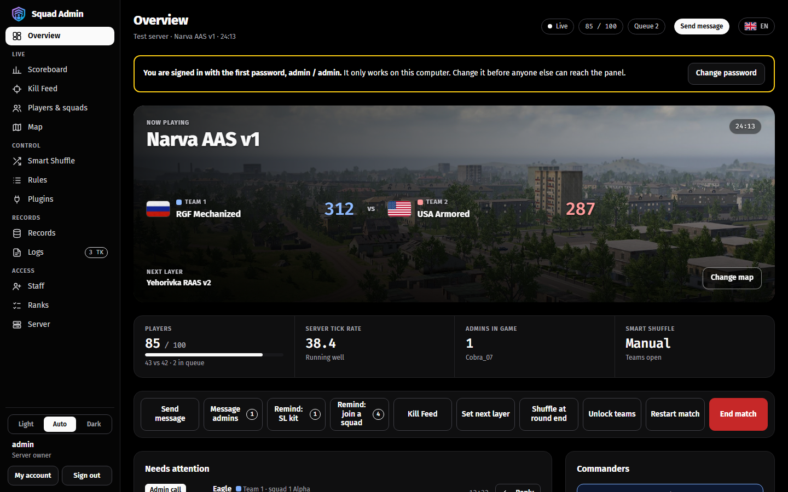
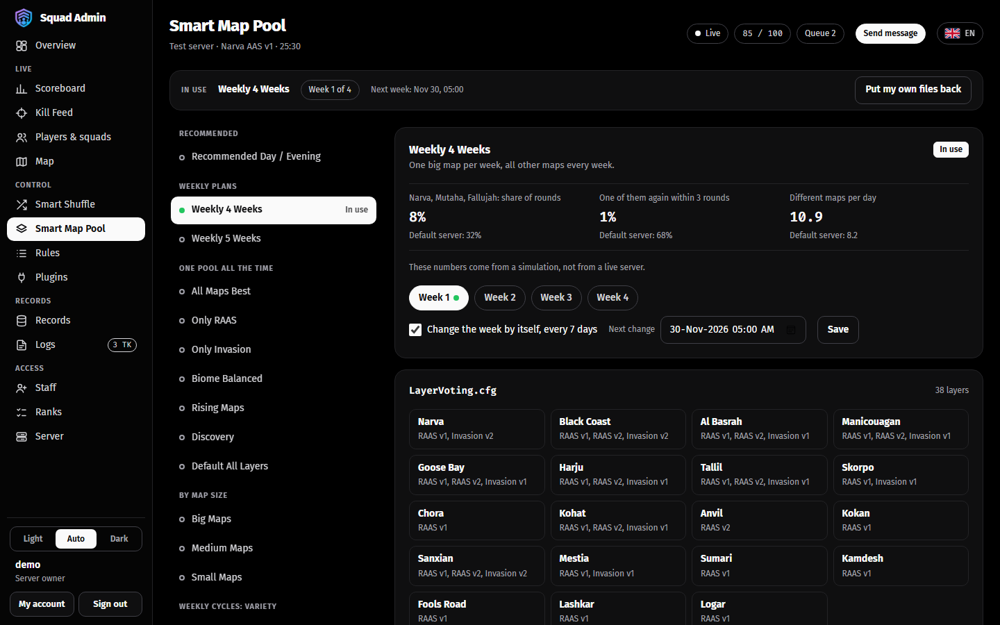

<div align="center">

# 📖 Squad Admin Panel Setup Guide

**v1.3.0 · Last updated 2026-11-28**

**English** · [Türkçe](./KURULUM_TR.md)

[Back to README](../README.md) · [Changelog](../CHANGELOG.md)

</div>

---

How to install Squad Admin Panel, a web admin and RCON tool that runs as a SquadJS plugin on a Squad dedicated server. See also the [Squad admin commands](./ADMIN_COMMANDS.md) reference.

This guide starts from zero. Follow the steps in order; each one says what you should see when it worked.

## 📑 Contents

- [Overview](#-overview)
- [Installation](#-installation)
- [Interface tour](#️-interface-tour)
- [Feature reference](#-feature-reference)
- [Configuration reference](#️-configuration-reference)
- [Troubleshooting](#-troubleshooting)
- [FAQ](#-faq)
- [Glossary](#-glossary)

---

## 🔭 Overview

### What it does

Squad Admin Panel is a web page for running a Squad server: see players and squads, warn, kick and ban, change the map, read chat and logs, and give your admins exactly the rights they need.

### How it works

```
Squad server  <-->  SquadJS  <-->  Admin panel (a SquadJS plugin)  <-->  your browser
        RCON + log files
```

It has not yet been tested on a live match with players.

---

## 📦 Installation

### Requirements

| What | Why |
|---|---|
| A Squad server with RCON | It is what you manage |
| Node.js 18 or newer | SquadJS and the panel run on it. SquadJS recommends 18. The panel was tested on Node 24 and 26, not on 18 |
| SquadJS, latest release (tested with 4.1.0) | The panel runs inside it |
| A browser | To open the panel |

Where SquadJS runs:

| Your case | What to do |
|---|---|
| Squad server on your own PC, or a Windows server you reach with Remote Desktop | Install everything there |
| Linux server | Install everything there and use an SSH tunnel to view the panel |
| Game hosting with only a web panel and FTP | You cannot install programs there. Run SquadJS on your PC or a VDS and let it read the logs over FTP or SFTP |

If SquadJS already runs, skip to step 3.

### Step by step

**1. Turn RCON on.** In `SquadGame/ServerConfig/Rcon.cfg` set `Password=<a long password>` and `Port=21114`, then restart the Squad server.

**2. Install SquadJS.** Install [Node.js](https://nodejs.org/en/download) and [Git](https://git-scm.com/downloads). Download the source zip of the [latest SquadJS release](https://github.com/Team-Silver-Sphere/SquadJS/releases/latest) and extract it. In that folder run:

```bash
npm install -g yarn
yarn install --ignore-engines
```

Do not use `npm install` for SquadJS. Fill the `server` section of `config.json` (`host`, `queryPort`, `rconPort`, `rconPassword`, `logReaderMode`, `logDir` with forward slashes, `adminLists`), and set `"enabled": false` on plugins that need Discord or a database if you do not use them. Start it with `node index.js`. See [SquadJS's own guide](https://github.com/Team-Silver-Sphere/SquadJS#using-squadjs).

**3. Copy the panel.** Download the zip from the [releases page](https://github.com/Miabeyefendi/Squad-AdminPanel/releases/latest) and extract `admin-panel.js` and the `admin-panel` folder into `squad-server/plugins/`. They must sit directly in `plugins`, with no extra folder in between.

**4. Add it to `config.json`**, at the end of the `plugins` list. Items are separated by commas, with no comma after the last one:

```json
"plugins": [
  { "plugin": "SeedingMode", "enabled": true },
  { "plugin": "AdminPanel", "enabled": true, "port": 8170 }
]
```

Check the file:

```bash
node -e "JSON.parse(require('fs').readFileSync('config.json','utf8')); console.log('config.json is fine')"
```

**5. Restart SquadJS** (`Ctrl+C`, then `node index.js`). You should see:

```
Admin panel on http://127.0.0.1:8170
```

**6. First sign in.** On the machine that runs SquadJS open `http://127.0.0.1:8170` and sign in with `admin` / `admin`. The panel opens. A warning stays at the top until you press **Change password** and set your own (10 characters or more).

<div align="center">

</div>

Change it **before** you set up any proxy or tunnel. While the password is `admin` / `admin`, every request is refused when it comes from another address, uses another host name or carries proxy headers, but a proxy that hides all of these would look like this machine.

### Remote access and more admins

By default the panel listens on `127.0.0.1` only. Choose one:

**Remote Desktop (Windows server).** Open the panel in a browser inside the server. Do not give moderators the server login.

**SSH tunnel (Linux server).** On your own computer run the command below, keep the window open and open `http://127.0.0.1:8170`. It needs SSH access to the server, so it is not for moderators.

```bash
ssh -L 8170:127.0.0.1:8170 USER@SERVER_IP
```

**Domain with HTTPS, for several admins.** The panel settings for this are covered by automated tests; it has not been tried with Caddy on a real server.

1. Change the first password (step 6). With these settings `admin` / `admin` no longer works anywhere.
2. Point a DNS A record such as `panel.example.org` to the server. Open ports 80 and 443. Do **not** open 8170.
3. Install [Caddy](https://caddyserver.com/download) and create a `Caddyfile`:

   ```
   panel.example.org {
       reverse_proxy 127.0.0.1:8170
   }
   ```

4. Change the panel line in `config.json` and restart SquadJS, then run `caddy run`:

   ```json
   { "plugin": "AdminPanel", "enabled": true, "port": 8170,
     "allowedHosts": ["panel.example.org"], "secureCookie": true, "trustProxy": true }
   ```

**Direct HTTPS** is also possible: put `cert.pem` and `key.pem` in `<dataDir>/tls/`; the panel then speaks HTTPS only. Listening on another address also needs `"allowRemote": true`. The panel refuses to open plain HTTP to a network.

Then register one account per admin on the **Staff** page. A new password is temporary and is changed at the first sign in.

### Verifying the install

The header says **Live**, **Players & squads** lists the players and **Map** lists the layers. With players on, send a message and check it appears in game.

### Updating

Stop SquadJS, copy the new `admin-panel.js` and `admin-panel` folder over the old ones, start it again. Accounts, records and logs stay in `admin-panel-data`.

### Uninstalling

Remove the `AdminPanel` line from `config.json` and delete `admin-panel.js` and `admin-panel` from `plugins`. Delete `admin-panel-data` too if you want the records gone; this cannot be undone.

---

## 🖥️ Interface tour

<div align="center">

</div>

| Page | What you do there |
|---|---|
| Overview | The match at a glance: `!admin` calls, repeated teamkills, squad leaders without the kit |
| Scoreboard | Both teams side by side; `sl1` finds squad 1 leaders, `sq3` squad 3 |
| Players & squads | Squads and live chat; the reply arrow messages only that player |
| Map | Pick map, mode, version and factions; **Set as next** or **Change now** |
| Smart Shuffle | **Control** for the match, **Settings** for everything else |
| Rules | Automatic rules, all off at first |
| Plugins | Other SquadJS plugins; changes apply after a SquadJS restart |
| Records | Warnings, kicks, bans and notes; deleting is on a separate red tab |
| Logs | Admin actions, teamkills, kills, chat, joins; any period, CSV export |
| Staff | Accounts and their permissions |
| Ranks | Default permissions of each rank (server owner only) |

---

## 🧩 Feature reference

### Player actions

**What it does.** A click on a name opens the player card: message, warn, move team, remove from squad, kick, ban, notes and history. The scoreboard boxes act on many players at once. Every action asks for confirmation.

**Limits.** Squad has no private message, so a message to one player is shown as an on-screen warning that is not counted. Squad answers a failed command with a normal reply; the panel shows that reply as an error. A wording not seen in testing could still pass as success.

### Staff and permissions

| Rank (power) | By default |
|---|---|
| Server owner (100) | Everything; exactly one account |
| Admin (80) | All up to critical, except permanent ban, mod account management, the grant right and sign in records |
| Senior mod (50) | Every free permission, short bans, next layer, rules page |
| Junior mod (20) | Chat and kill logs, notes, warn |

Each permission has a power that decides who may hold it:

| Class (power) | Permissions | Who may hold it | Who hands it out |
|---|---|---|---|
| Basic (0) | live screens, own account | everyone | fixed |
| Free (10 to 49) | chat and kill logs, notes, warn, squad removal, player and team messages, broadcast, kick, team move, Smart Shuffle round actions | junior and up | owner, or an admin with the grant right |
| Senior (50 to 69) | 1 hour and 1 day bans, 7 and 30 day bans, next layer, see rules, admin log, Smart Shuffle switches | senior and up | owner, or an admin with the grant right |
| Critical (70 to 89) | permanent ban, change layer now, end or restart match, edit rules, all Smart Shuffle settings, manage mod accounts, grant right, sign in records | admins | owner only |
| Locked (100) | plugin settings, restart SquadJS, admin accounts and ranks, rank defaults, handing over ownership, deleting records | owner | nobody |

Rules enforced by the server on every request:

1. Only a higher rank can change an account.
2. An admin gives or takes only what they have themselves.
3. Nobody changes their own permissions.
4. An account registered by an admin starts without anything that admin lacks, and an admin cannot reset the password of an account that can do more.
5. Changes apply to open sessions at once, ask for your password again and are logged.

### Scoreboard and commanders

Kills, downs, deaths, K/D, revives, teamkills and damage are counted from the server log while the panel runs. Score points and ping are not available from Squad. Columns have fixed widths and the order is held while numbers change. The commander is the leader of the squad named "Command Squad"; with two on one team the lower number counts and the panel names the other.

### Smart Shuffle

[Smart Shuffle](https://github.com/Miabeyefendi/Squad-SmartShuffle) comes with the panel. Settings apply at once without a restart. If the `smart-shuffle` folder is removed, everything else keeps working. A `SmartShuffle` line that `config.json` already runs stays in charge; remove it to manage Smart Shuffle here.

### Automatic rules

Teamkill limit, players without a squad, squad leader without the SL kit, small locked squads, chat filter, name filter. All are off until switched on, and server admins are exempt. Start with the warning step only. Disbanding a squad has not run on a real server. If the SquadJS plugins AutoTKWarn or AutoKickUnassigned are on, the owner sees a note that both would act.

### Records and logs

Player records survive restarts and log deletion; by default they are kept for ever and logs for 90 days. The server owner sets how long each kind is kept, or deletes by age, month, date range or everything, after a preview, typing `DELETE` and the password. The deletion is logged.

### Flags and map pictures

The panel draws its own flags and map patterns and ships no game images. To use your own, add png, jpg or webp files, named after the layer prefix (`Narva.jpg`) or the faction (`USA.png`):

| Folder | Where it shows |
|---|---|
| `<dataDir>/art/screens` | Behind the running match on Overview, and the running and next match on Map. Wide scenery such as a loading picture, 16:9, up to 2560 px |
| `<dataDir>/art/maps` | The map picker: the map seen from above |
| `<dataDir>/art/factions` | Faction flags |

Without a file in `screens` the panel shows its own drawing there, never the map from above. Use only pictures you are allowed to use. They are shown to signed in accounts only.

---

## ⚙️ Configuration reference

All keys go on the `AdminPanel` line of `config.json`. **Put no passwords there:** SquadJS sends plugin options to its own ping service.

| Key | Default | Effect |
|---|---|---|
| `host` | `127.0.0.1` | Address the panel listens on |
| `port` | `8170` | Port of the panel |
| `allowRemote` | `false` | Needed, with a certificate, to listen beyond this machine |
| `allowedHosts` | `[]` | Extra host names the panel answers to |
| `secureCookie` | `false` | Turn on when a proxy serves the panel over HTTPS |
| `trustProxy` | `false` | Turn on when a proxy on this machine sets `X-Forwarded-For` |
| `idleMinutes` | `60` | Sign out after this long without a request |
| `sessionHours` | `12` | Longest a sign in lasts |
| `allowRestart` | `false` | Lets the owner stop SquadJS from the panel; use only if a service manager such as pm2 starts it again |
| `serverConfigDir` | empty | The game server's `ServerConfig` folder, for Smart Map Pool |
| `dataDir` | `./admin-panel-data` | Accounts, records, rules and logs |
| `configFile` | `./config.json` | File the Plugins page edits; the previous version is kept as `.bak` |
| `retentionDays` | `90` | Days to keep logs until the owner changes it; 0 keeps them |
| `refreshSeconds` | `5` | Player list refresh while the panel is open |

### Where the settings are stored

`admin-panel-data/`, encrypted with AES-256-GCM. The key is `secret.key` there, or the `SA_DATA_KEY` environment variable (24 characters or more, set before the first start). Back the folder up and never share it. Without the key the data cannot be recovered. **Whoever can read and change files on the server can take over the panel.**

---

## 🔧 Troubleshooting

### The page does not open

**Cause.** SquadJS is not running, the plugin did not load, or the browser is on another computer.
**Fix.** Look for `Admin panel on http://127.0.0.1:8170` in the SquadJS window. Use `http`, not `https`, unless you set up HTTPS. From another computer see remote access.

### `Could not listen on 127.0.0.1:8170`

**Cause.** The port is taken. **Fix.** Set another `port`.

### `admin` / `admin` says wrong name or password

**Cause.** The first password was already changed, or you are not on the server itself, or `trustProxy` is on.

### "Too many tries. Wait a while."

**Cause.** Too many wrong passwords. **Fix.** Wait; the delay grows up to one hour.

### I forgot my password

In the SquadJS folder:

```bash
node squad-server/plugins/admin-panel/users.js ./admin-panel-data set yourname owner
```

It asks for a password (hidden while typing) and prints `Saved yourname (owner).`. The former owner becomes an admin. `list` shows the accounts and `remove <name>` deletes one.

### "Unknown host name."

**Fix.** Add the name you used to `allowedHosts`.

### `Not started: host ... is open to the network`

**Fix.** Set `host` back to `127.0.0.1`, or set up TLS and `allowRemote`.

### Kills and teamkills stay at 0

**Cause.** They come from the log SquadJS reads, counted since the panel started. **Fix.** Check `logDir` or the FTP settings.

### Collecting a log for a bug report

Copy the error lines from the SquadJS window. Remove RCON and FTP passwords, IP addresses and player IDs. Never share `secret.key`.

---

## ❓ FAQ

**Do players need a mod?**
No. Nothing is added to the game.

**Do I install Smart Shuffle separately?**
No, it is included.

**Why is there no score or ping?**
Squad sends neither over RCON nor in the log.

**Does the panel work while my PC is off?**
Only if SquadJS runs somewhere else. For 24/7, run SquadJS on a server as a service, for example with pm2.

---

## Languages, announcements and Discord (1.1.0)

- **Language:** click the flag at the top right. The choice is kept in that browser.
- **Announcements:** open **Server**, add a message, choose when it is sent, then **Save announcements**.
- **Discord:** in Discord open the channel settings, **Integrations**, **Webhooks**, create one and copy its address. Paste it on the **Server** page, tick **Send notices to Discord**, save, then **Send a test message**. Only the server owner can do this. Treat the address like a password.
- **Server password:** the panel refuses to set it when `logger.verboseness.RCON` in the SquadJS `config.json` is 2 or higher, because SquadJS would print the password.

---

## Kill Feed and quick actions (1.2.0)

- **Kill Feed** (needs the right to read kill logs): every down and kill with attacker, victim, weapon and damage. **Every hit** shows each hit on its own line, **Teamkills** only friendly fire.
- Click a row, or a player on the **Players** tab, to see one attacker: hits per down, one hit downs, top hit, most downs within 60 seconds and each weapon. A name opens the player card.
- **Last match** keeps the match that just ended. Both are held in memory: restarting SquadJS or the panel empties them. **Export CSV** saves what is on screen. The kill log under **Logs** stays on disk.
- **Reading the numbers:** the server log has no missed shots, no hit place and no distance, so there is no accuracy. Marksmen, machine guns, explosives and vehicles change these numbers a lot. Treat them as a reason to watch a player, not as proof.
- **Quick actions** on the overview: a number on a button says how many players it reaches. Reminders are on screen messages and are not counted as warnings.

---

## Smart Map Pool (1.3.0)

- **What it does:** a Squad vote server reads its map pool from fixed files in `SquadGame/ServerConfig`. Pick a pool and the panel writes it there. The pool before it is no longer used.
- **Needs:** `MapRotationMode=LayerList_Vote` and `UseVoteLayer=true` in `Server.cfg` (the panel only reads that file and warns you), and access to the folder. It is found by itself when SquadJS runs on the game server's machine with `logReaderMode: "tail"`. Otherwise add `"serverConfigDir": "C:/SquadServer/SquadGame/ServerConfig"` to the AdminPanel line. A server that SquadJS reads over FTP or SFTP is not supported yet.
- **Right:** **Choose the map pool**. Only the server owner has it until it is given to an admin. Every change asks for your password and goes to the admin log.
- **What is written:** `LayerVoting.cfg`, `LayerVotingNight.cfg`, `LayerVotingLowPlayers.cfg`, and in `VoteConfig.cfg` only the lines the pool sets.
- **Going back:** **Put my own files back** restores what the files and lines held before. A plain copy is also in `<dataDir>/map-pool-backup/before-panel/`.
- **Changed by hand:** if a file the panel wrote was edited, nothing is written over it without asking; a copy is kept when you agree. The weekly change stops instead.
- **Weekly pools:** **Change the week by itself, every 7 days** is on when you pick one. Set **Next change** to a quiet hour (for example Monday 05:00) and **Save**: no file has to be touched again. It works while SquadJS runs, the panel does not need to be open in a browser, and after being off it catches up.
- **Restart:** it is not verified whether Squad reads these files while running. Restart the game server to be sure, also after a weekly change.
- The numbers on the page come from a simulation in [Squad-MapPool](https://github.com/Miabeyefendi/Squad-MapPool), not from a live server.

<div align="center"></div>

---

## 📕 Glossary

| Term | Meaning |
|---|---|
| SquadJS | Free framework that connects to a Squad server and runs plugins |
| RCON | The connection programs use to send server commands |
| Layer | Map, mode and version together, such as `Narva_RAAS_v1` |
| Reverse proxy | A program that receives web requests and passes them to the panel |

---

<div align="center">

<br/>
<sub>Built by <b><a href="https://github.com/Miabeyefendi">Miabeyefendi</a></b> · <a href="../README.md">Back to README</a></sub>
</div>
